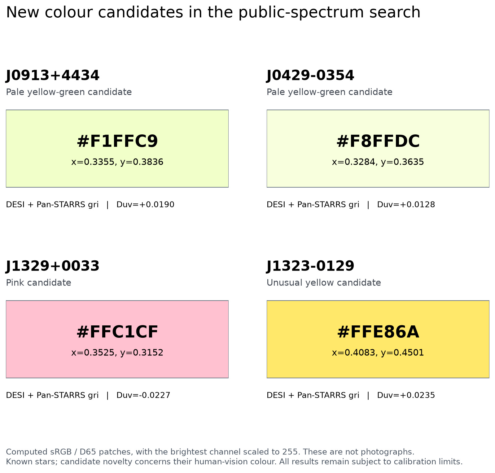
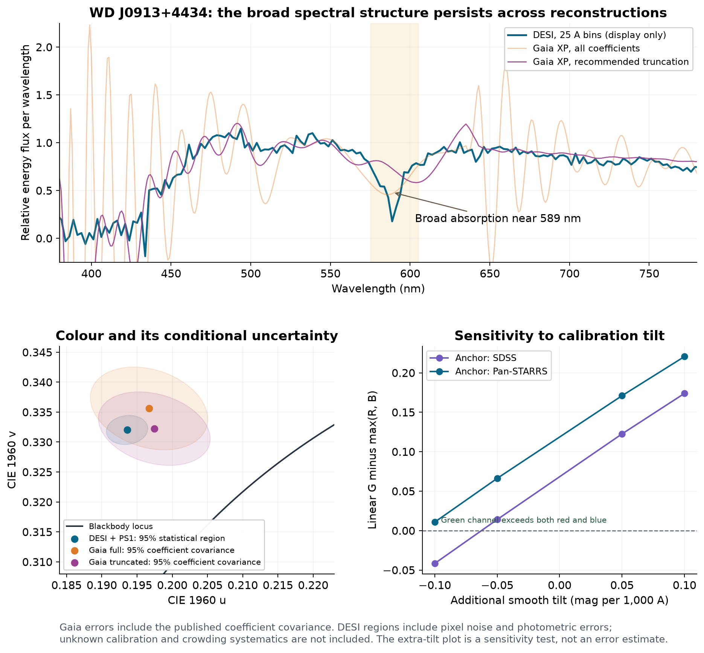
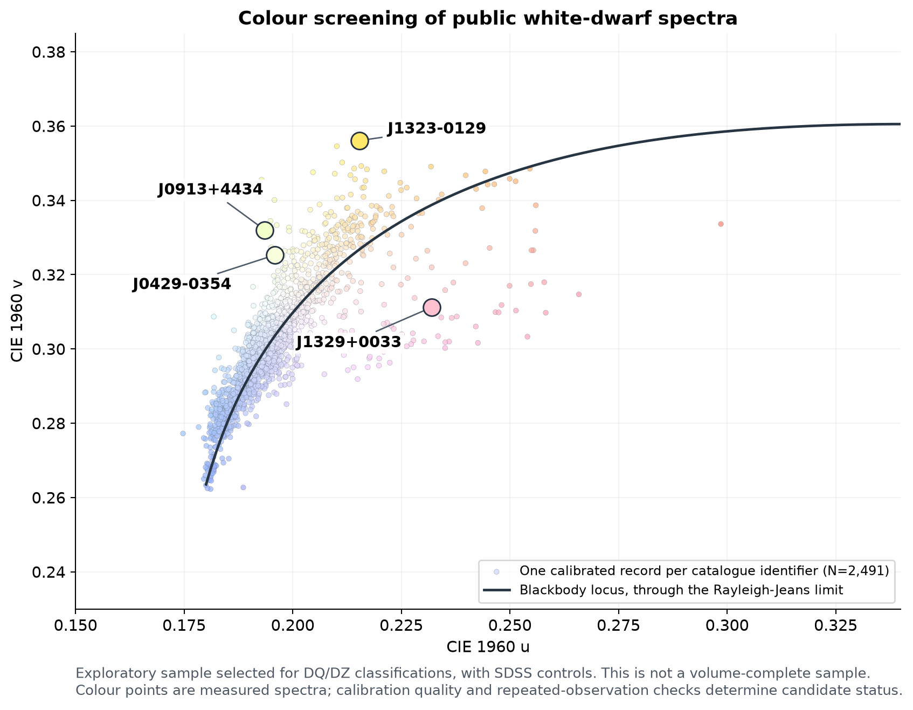

[English](report.en.md) | **日本語**

# 公開スペクトル9,902記録からの、白色矮星の新しい色の候補

解析日：2026年10月18日

## 今回得られた研究結果

公開された観測データを実際に取得・計算し、**WD J0913+4434 と WD J0429−0354 を、追加の淡い黄緑色白色矮星候補として抽出した**。両天体はHollands et al. (2026) の人間視覚色を調べた論文の236名称の対象一覧にない。DESIスペクトル、Gaia XPの元係数からの再構成、測光による再校正を比較し、平均の色が黄緑寄りになることを確認した。

さらに、ピンク色の **WD J1329+0033** と、通常の黒体の色から外れた黄色の **WD J1323−0129** を追加の色の測定候補として残した。

新規性の範囲は、**既知の星について、人間の目に対応する色度を新たに計算・検証したこと**である。これらは既に観測・分類されている星であり、天体自体、温度、元素、吸収機構の発見を主張するものではない。確認した先行研究では各対象のCIE色度やsRGBの報告を見つけられなかった。ただし、未索引文献や未公表の計算も含めた世界的優先権は証明していない。

色見本は観測スペクトルから計算したsRGBであり、天体写真ではない。最大の表示チャンネルを255に揃えているため、星表面の実際の明るさも示していない。

## 1. 主要候補の数値

条件を揃えるため、この表の代表値は全て **DESIスペクトルをPan-STARRSのg・r・i測光に合わせた場合**である。

| 対象 | Gaia DR3 source_id | 色の候補 | CIE x | CIE y | sRGB | Duv | 条件付き95%区間 |
|---|---|---|---:|---:|---|---:|---|
| WD J0913+4434 | 818833831355548928 | 淡い黄緑 | 0.33548 | 0.38355 | #F1FFC9 | +0.01901 | +0.01695 ～ +0.02112 |
| WD J0429−0354 | 3204436719718449280 | 淡い黄緑 | 0.32845 | 0.36353 | #F8FFDC | +0.01281 | +0.01197 ～ +0.01365 |
| WD J1329+0033 | 3711047662972690688 | ピンク | 0.35245 | 0.31521 | #FFC1CF | −0.02265 | −0.02481 ～ −0.02048 |
| WD J1323−0129 | 3638333660492606976 | 異常な黄色 | 0.40830 | 0.45014 | #FFE86A | +0.02348 | +0.02094 ～ +0.02597 |

Duvは、CIE 1960色度図での黒体の色の軌跡からの最短距離に符号を付けた指標である。Hollands2026にならい、距離0.01を探索上の外れ値の目安にした。これは普遍的な人間の色の識別限界や、発見の有意水準ではない。**Duvが正というだけで緑色とは言えない。** J1323−0129はその具体例で、黄色に相当する。

95%区間は、公開DESI画素誤差と測光誤差に基づく6,000回の乱数試行から求めた。画素間相関のない近似で、測光誤差には0.02等の下限を入れた。未知の流束校正誤差、混入光、探索後の選択効果などを含む完全な誤差予算ではない。6,000回全てが同じ色側になっても、その色が100%確実に実在するという意味ではない。

詳細な値、校正ごとの結果、乱数試行の区間は [validated_colours.csv](../results/candidates/validated_colours.csv)、上の代表値は [headline_candidates.csv](../results/headline_candidates.csv) に保存した。

## 2. 最も注目する2天体

### WD J0913+4434

完全な名称は **WDJ091336.37+443405.41**。SDSS J091336.38+443405.4等の別名がある。Gaiaの視差12.7362±0.3484 masから単純に逆数を取ると約78.5 pc、約256光年である。温度約4,662 K、DZ分類、ヘリウム主体の大気、金属を含むモデルは既存のKilic2026カタログに由来する。今回新たに推定した温度や組成ではない。

この天体では、次の条件でも平均の色が黄緑寄りに残った。

| データ・処理 | sRGB | Duv |
|---|---|---:|
| DESI、流束の傾斜を補正する前（無効画素・狭い夜光窓を除く） | #F5FFC7 | +0.01835 |
| DESI＋SDSSの公式PSF測光 | #F7FFC6 | +0.01789 |
| DESI＋Pan-STARRS測光 | #F1FFC9 | +0.01901 |
| Gaia公式係数、全55 BP＋55 RP基底 | #F7FFBF | +0.01923 |
| Gaia公式係数、推奨10 BP＋2 RP基底 | #F9FFC9 | +0.01635 |

GaiaとDESIの間で、可視域の幅広い吸収の形も比較した。特に589 nm付近の落ち込みと青側の光の抑制は、通常の滑らかな熱放射だけからは離れた形である。既存の大気モデル図もその形を定性的に再現している。既存論文は金属元素を個別に全て自由推定してはいないため、ここから新しいナトリウム量や惑星物質の組成を決定したとは言えない。

単純な形状実験として、この幅広い落ち込みを周囲を結ぶ直線で人工的に埋めると、表示色のG−Rの符号が反転し、黄緑から黄色寄りになる。これは吸収の形と色の関係を示す診断であって、ナトリウムを取り除いた物理的な大気モデルではない。

**残る制約：** 約5.342秒角離れた赤い背景天体がある。SDSSは両者を別の子天体として分離し、対象のCLEANは1だが、rバンドに補間・宇宙線のフラグがある。Gaia BP/RPにも各48回中4回の混合フラグがある。これらは候補を直ちに否定する証拠ではないが、混入がゼロだとは断定できない。

### WD J0429−0354

完全な名称は **WDJ042944.71−035422.00**、Gaia IDは **3204436719718449280**。既存カタログではDZ、Kilic2026のモデル温度は約5,288 Kである。

DESIをPS1で補正した色は `#F8FFDC`、Gaiaの全基底で `#FAFFD7`、推奨4 BP＋2 RP基底で `#F7FFD3`となった。こちらはJ0913より白に近い淡い黄緑である。DESIの条件付きDuv区間は+0.01197～+0.01365で、今回の探索基準0.01を上回る。

公式Gaiaの10秒角検索には対象以外の掲載天体がなく、PS1の測光も元カタログの値と一致した。PS1の同じ範囲の別ソースは、約9.736秒角離れたiバンドのみの暗い2検出天体だった。カタログの検出限界以下の混入まで否定したわけではないが、J0913より近傍天体の懸念が少ない。

## 3. Gaiaの誤差を調べると、断定できる範囲が狭くなる

MWDDに表示されるGaia XPの波打ちは、誤差が小さいことを意味しない。元のESA XP_CONTINUOUS係数、係数誤差、全相関を取得し、GaiaXPy 2.1.5で再構成した。MWDDの公開XP値は、全55基底を330～1,050 nmの対数間隔361点で再構成したFλと、丸め誤差程度で一致した。これにより、FνをFλと誤解して色を計算した可能性も点検できた。

係数共分散を波長サンプル、さらにXYZ積分へ直接伝播し、各200,000回の相関した乱数試行を行った。

| 対象 | Gaiaの再構成 | Duvの形式的1σ | Duvの形式的95%区間 | Gが最大となる試行割合 |
|---|---|---|---|---:|
| J0913 | 全基底 | +0.01923±0.00351 | +0.01236～+0.02612 | 85.0% |
| J0913 | 推奨基底数 | +0.01635±0.00327 | +0.00995～+0.02274 | 77.8% |
| J0429 | 全基底 | +0.01299±0.00220 | +0.00867～+0.01730 | 82.3% |
| J0429 | 推奨基底数 | +0.01493±0.00180 | +0.01141～+0.01846 | 96.5% |

したがって、**Gaia単独で緑色を強く確定したという結論にはしない**。平均値が同じ側にあり、通常の黒体の色から外れる傾向は追認するが、GがRを上回る色名の境界は不確かである。推奨基底数への切り詰めによるバイアスや、未提供のBP/RP間の校正相関も誤差には含めていない。

同じ測光に合わせたGaiaとDESIには共通の校正誤差が入るため、それぞれの確率を独立として掛け合わせることもしない。

再構成手順、元係数、共分散、環境、確認結果は [Gaia再構成監査](../mwdd/gaia_validation/README.md) に保存した。

### 独立したDESIカタログで混入を照合

[Swan et al. 2026](https://arxiv.org/html/2609.04314v1) の公開表も取得し、Gaia近傍天体・観測時の固有運動・シーイングを使った混入推定と照合した。主要4候補ではDESIへの推定混入はごく小さかった。J0913の近傍光／対象光の推定比は約3.1×10⁻¹⁴、J0429は表上0である。これはガウス型PSFを仮定した計算結果であり、PSFの翼や未検出天体、隣接ファイバー間の漏れまで含む厳密な上限ではない。Gaiaの混合フラグが存在する事実は別に残す。

同じ表でLP 616−53はWD+MSと分類され、DESIの混入比は約0.0307、SDSS測光で約0.706、PS1測光で約0.765だった。これらは全光量中の割合ではなく、近傍光を対象光で割った値である。この独立情報は、当該天体を単独白色矮星の新しい色の主張から外す判断を支持する。

同論文は、別のDESI天体で幅広いNa様吸収が追観測では再現されなかった例も報告している。そのため、今回の吸収の見かけだけから元素や物理機構を確定しない。対象ごとの抽出値は [混入推定の抽出表](../novelty/swan2026_candidate_contamination.csv) に、元ファイルのURL・SHA256・元の行は [元表の監査記録](../novelty/swan2026_candidate_audit.json) に記録した。

## 4. 探索の広さと、誤検出を除くために実施したこと

| 段階 | 実施した内容・件数 |
|---|---|
| MWDDカタログ | 163,279行の公開表を取得 |
| 主探索標本 | DQ/DZを中心とした5,548天体、8,505スペクトルを取得 |
| 独立したSDSS取得 | Q/Z型1,343観測＋対照54観測＝1,397本のFITSを取得 |
| 全走査 | 合計9,902スペクトル記録。重複観測を含む |
| 形式・波長条件を満たした記録 | 9,023。これ自体を新発見数としては扱わない |
| 既知の比較論文 | 236名称の全対象表を抽出し、位置と別名で照合 |
| SDSSの測光検査 | 1,390観測で公式PSF測光を回収。元表と0.05等を超えて違う値が84バンド分 |
| 正常な対照 | DA/DC/DB各18観測。54本とも黒体からの距離0.01未満、最大0.00671 |
| 主要候補 | 複数スペクトル、異なる測光系、ノイズ、滑らかな傾斜、近傍天体、先行研究を重点検査 |

数値的に同じスペクトルを別名で二重に持つ例もあり、MWDDの8,505記録は8,502の数値的に異なるスペクトルに相当する。SDSSから直接取得したFITSとMWDDのSDSSにも同じ観測が含まれ得る。GaiaやDESIという独立した観測装置の一致と、単にファイルが2個あることは区別した。

**既知例での再現：** J0851+1543は公表sRGB `#F1FFF8` に対して `#F1FFF7`、ピンク色J1011+2845は今回のPS1校正で公表 `#FF8775` と一致した。J1330+6435など、元論文のモデルと利用可能な観測の違いが大きい例では差を残し、全てを厳密に再現したとはしていない。

**実装の内部検証（別経路の計算）：** 色積分、CIE 1960座標、sRGBの伝達関数、流束補正による逆分散の変更を別経路で点検した。J0913について80回の完全な非線形再フィットと一次近似の乱数試行を比較した際のDuv差は、RMS 1.22×10⁻⁶、最大3.60×10⁻⁶だった。現在の誤差幅に比べて十分小さい。較正前に無効画素・狭い夜光を処理するかによる差も、主要候補の結論を変えなかった。これらは、別に担当させたAIによる点検を含む内部の計算検証であり、外部の人間の専門家による審査や学術誌の査読を受けたという意味ではない。

図は校正可能な記録から天体名称ごとに1点を選んだ探索分布である。DQ/DZを意図して多く含めた標本なので、ここから「宇宙の白色矮星の何%が緑か」を推定していない。

## 5. 残さなかった主張

### LP 616−53 / J1258+0106：混入の懸念で格下げ

この天体のDESIスペクトルは `#F4FFCC`、Duv≈+0.01727と見えた。しかし、約2.30秒角の明るい伴星と約1.29秒角の別ソースがある。GaiaではBPの7回中5回、RPの6回中5回が混合フラグを持つ。高い画素信号対雑音比だけで安全な単独星の色と判断することはできず、主要候補から外した。

### J1552+2023：誤った測光による極端な色

SDSSのr・iが異常に暗く誤差も大きいカタログ値を強制的に使うと、不合理な傾斜と残差を伴った極端な青が作られた。補正前のGaia・DESIスペクトルは通常の暖色であり、信頼できる別測光とも整合する。校正の品質条件により除外した。

### J1323−0129：色は測れるが、物理量の新発見にはしない

SDSSとDESIの色はいずれも黄色で、校正を変えても黒体からのずれが残った。一方、既存の2025年と2026年のモデルでは推定温度が約4,262 Kから約3,648 Kへ変わっている。モデル系統差を無視して小さな形式誤差だけを報じたり、黄色の原因となる元素量を新しく決めたとはしない。

その他の単一スペクトル候補、校正できない候補、Gaiaだけで極端な色を示す候補は全走査表に残した。これらは追加調査の優先順位を付ける対象であって、新しい星の発見一覧ではない。

## 6. 新規性の監査

Hollands2026の全対象だけでなく、そのDZの親標本であるHollands2017の231天体とも照合した。主要候補について、SIMBADの別名と文献、Kilic2020/2025/2026、Vincent2023/2024などの本文・表・公開モデル図を確認した。

既存研究では、各星の分類や大気パラメータ、天文学的な色指数は報告されている。それと、人間の等色関数を積分したCIE色度・sRGBを報告することは異なる。今回の確認範囲では、主要候補について後者の記載を見つけられなかった。

監査記録 [novelty_evidence.csv](../novelty/novelty_evidence.csv) は、各資料が証明することと証明しないことを分けて記録している。見つからなかったという検索結果だけで、あらゆる先行研究の不存在を証明したとはしない。

## 7. 再現手順と残る検証

[日本語ノートブック](../white_dwarf_colour_research.ja.ipynb) は、主要候補の元ファイルのSHA256照合、色の再計算、Gaiaの再構成値の確認、全走査の集計を行う構成である。実行環境とコマンドは [再現手順](reproducibility.en.md) に、計算値の検証は [検証スクリプト](../scripts/verify_reproduction.py) にまとめた。

現在の公開Gitツリーは圧縮前で約80 MBで、MWDDの選択済み原CSV25本と配列25本、SDSSの対照FITS54本と配列54本、約21 MBのGaia元係数・再構成・共分散監査を含む。主要候補・既知例・対照の検査に必要な選択済み入力はGitに同梱され、別のリリース資産を取得する必要はない。全走査の [all_spectra_screen.csv.gz](../results/all_spectra_screen.csv.gz) と、[MWDDマニフェスト](../mwdd/manifest_enriched.json.gz)、[SDSSマニフェスト](../sdss/manifest_with_photometry.json.gz)、[原ファイルのSHA256一覧](../mwdd/source_checksums.csv.gz) も同梱した。

全標本の元スペクトル約2 GBは、公開URLとSHA256を記録した [凍結標本の取得スクリプト](../download_frozen_spectra.py) で再取得できる。全MWDDカタログ、Swanの一括アーカイブ、論文全文やモデル図の一括キャッシュはGitに含めていない。データの所在と出典別の利用条件は [データ案内](data-availability.md) に記載した。

主要候補の色をさらに確実にするには、近傍天体と分離した独立の可視分光、数%程度の相対流束校正、再観測の一致が有効である。未取得の新しい観測があるかのようには扱わない。次の論文として提示できる中心は、追加候補の標準化した色度測定、既知例との比較、校正と共分散まで含めた再現可能な検証である。

**現在の判断：追加の黄緑色候補2天体を得た。通常の黒体から外れた色の証拠はあり、世界初・色名・物理機構を全て確定したという段階ではない。**

## データと参考文献

- [Hollands et al. 2026, Any colour you like: The diverse chromaticities of white dwarfs](https://arxiv.org/html/2610.18966v1), DOI: [10.1093/rasti/rzag069](https://doi.org/10.1093/rasti/rzag069).
- [Montreal White Dwarf Database](https://www.montrealwhitedwarfdatabase.org/), Dufour et al. 2017。星ごとのスペクトルURLと取得時点のSHA256はマニフェストに記録。
- [Kilic et al. 2026, A Detailed Model Atmosphere Analysis of Cool White Dwarfs in DESI DR1](https://arxiv.org/html/2606.25377v2), DOI: [10.3847/1538-4357/ae825f](https://doi.org/10.3847/1538-4357/ae825f)。[公開モデル図](https://doi.org/10.5281/zenodo.20775938)。
- [Vincent et al. 2024, Classification and parameterisation of a large Gaia sample of white dwarfs using XP spectra](https://arxiv.org/abs/2308.05572), DOI: [10.1051/0004-6361/202347694](https://doi.org/10.1051/0004-6361/202347694)。
- [Kepler et al. 2019 の公開カタログ](https://cdsarc.cds.unistra.fr/ftp/J/MNRAS/486/2169/), DOI: [10.1093/mnras/stz960](https://doi.org/10.1093/mnras/stz960)。
- [Hollands et al. 2017 のDZ親標本](https://cdsarc.cds.unistra.fr/ftp/J/MNRAS/467/4970/ReadMe)。
- [Swan et al. 2026, The DESI Data Release 1 white dwarf catalogue](https://arxiv.org/html/2609.04314v1)。[公式公開表](https://cygnus.astro.warwick.ac.uk/phsdaj/WhiteDwarfs/)。
- [CIE公式1931等色関数](https://cie.co.at/datatable/cie-1931-colour-matching-functions-2-degree-observer), DOI: [10.25039/CIE.DS.xvudnb9b](https://doi.org/10.25039/CIE.DS.xvudnb9b), CC BY-SA 4.0。公式MD5 `17cca777db64b17170f06f67ce9d3ab7` と一致を確認。
- [Gaiaの公開データ取得](https://www.cosmos.esa.int/web/gaia-users/archive/programmatic-access)、[GaiaXPy](https://gaia-dpci.github.io/GaiaXPy-website/)、[SDSS DR17分光仕様](https://www.sdss4.org/dr17/spectro/spectro_basics/)、[Pan-STARRS公開API](https://catalogs.mast.stsci.edu/docs/panstarrs.html)。

原観測・原カタログ・原モデルは各著者およびサーベイに帰属する。本成果物は **Shota Moriwakiの指示のもとでChatGPTが実行した公開データ再解析** であり、外部の専門家による審査・学術誌の査読・原著者による承認を受けたとの主張はしない。詳しくは [研究の誠実性とAIの関与](research-integrity.md) を参照。独自コードは所有者が選択したApache License 2.0、独自の文章はCC BY 4.0とし、第三者のデータ・図の構成要素には原条件を保持する。[ライセンスの適用範囲](../LICENSES/README.md) と [指定謝辞](../ACKNOWLEDGMENTS.md) を同梱した。
