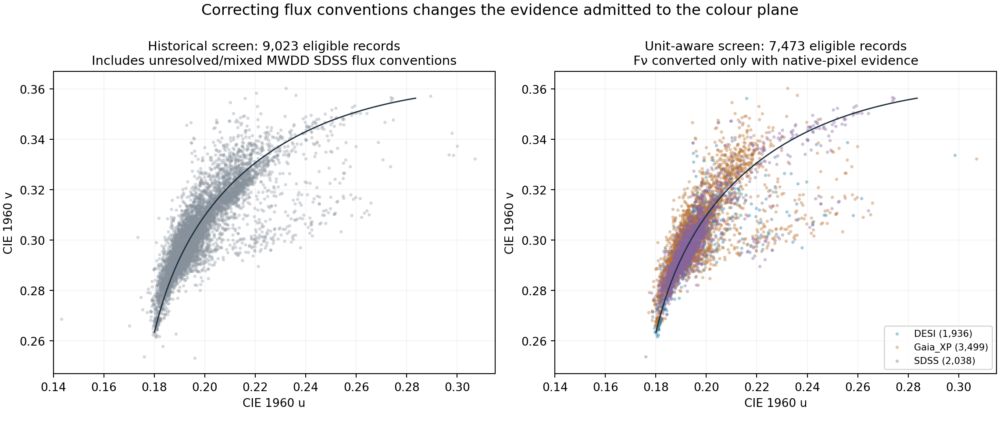
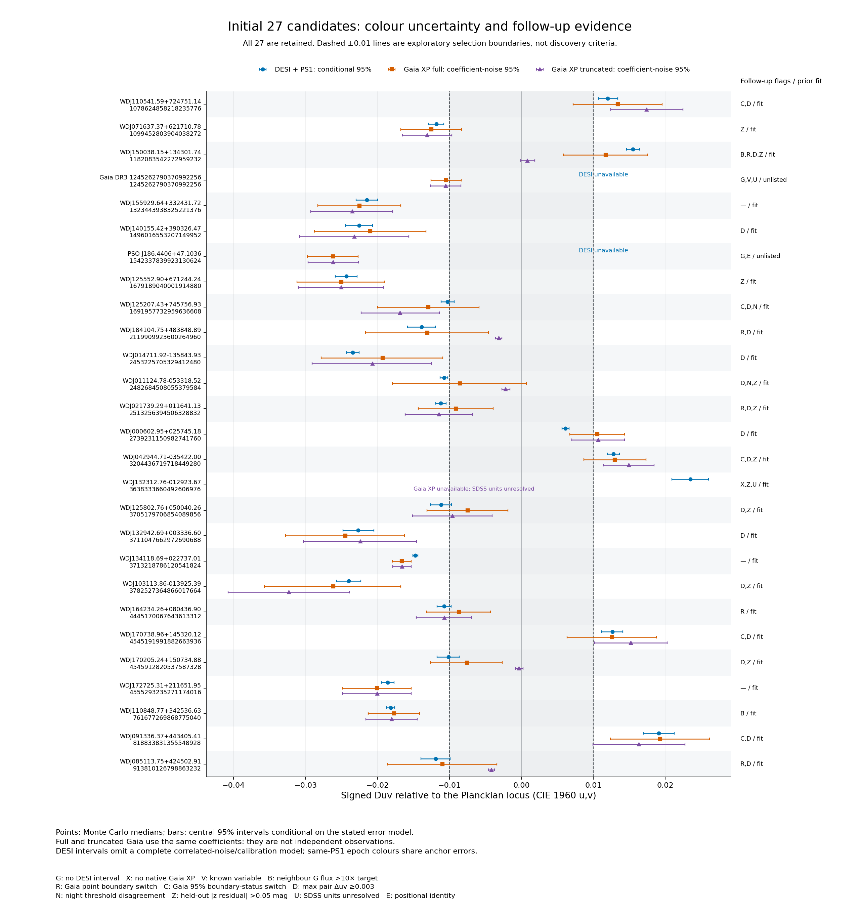

# 異常色の白色矮星を、検証できる研究へ

**2026年10月20日 UTC 更新。研究版0.2.0に日付付きの追解析を追加。プロジェクト：Shota Moriwaki。ChatGPTの支援による追加解析・執筆を含む、未査読の研究記録です。** [English](README.md) ／ [プロジェクト入口](../README.md)

## 現行要約 — 2026年10月20日

[10月20日の追加報告](FOLLOWUP_2026-10-20.ja.md)（[English](FOLLOWUP_2026-10-20.en.md)）に、原観測との単位照合、別撮像の実測測光、実測値と提案バンドによる制約、反復スペクトルの形状診断をまとめました。研究版は0.2.0のままで、物理的発見や新しいリリースの確定を意味しません。

| 現在の対象範囲 | 結果と根拠 |
|---|---|
| 変更していない元台帳 | 9,902記録／6,003 entity key |
| 対象を限定して更新した科学選別 | **適格8,074／強外れ419記録・324 entity key**：[集計](unit_resolution_followup/science_view_summary.json)・[閲覧画面](unit_resolution_followup/current_view.html) |
| MWDD経由SDSSの単位 | **Fν 327／Fλ 939／未解決966**：原観測から追加613記録を確定 |
| 追加613記録の元画素支持 | **色の採用601／保留12**：旧基準互換計算の後に10記録を追加保留、2記録は以前から不適格 |
| 以前は表示不可だった対象 | 115対象の単位を解決、112対象の色計算を回復 |
| 実際の追加閲覧 | 613記録・39画像の全パネル：[個別記録](unit_resolution_followup/individual_review.md)・[完了根拠](unit_resolution_followup/review_completion.json) |
| 別の撮像による実測測光 | 固定25候補：**450枠／厳格品質52測定／全波長被覆46測定／14対象**：[原本・品質監査](independent_photometry/README.md) |
| 実測バンドを使った制約 | **165設定／660最適化分岐**：[測定設計報告](measurement_design/README.ja.md) |
| 提案バンドの識別実験 | **276設定＋端点閉包8設定／568分岐**：同報告。取得した実測値とは別の実験 |
| 反復スペクトルの形状 | DESIの4組、SDSSの**5夜・18実露出からなる2 coadd**：[反復報告](repeat_shape_validation/README.ja.md) |

**元画素の支持を新しく監査した範囲は613記録です。全台帳ではありません。** 以前の適格7,473記録は、元の計算を保持しています。保存した旧基準互換集計 **8,084／421／325** は、新しい欠測・支持の保留を反映する前の比較値です。現在の科学選別と混同しないでください。10月18日とv0.1の数値も当時の記録として残しています。

**J1323−0129の証拠は更新されました。** SDSSは同一原観測との照合でFλと確認でき、正のDuvを定性的に支持する計算が回復しました。一方、native S/N 2.36と、固有運動を考慮してもSDSSのPLUG位置から約1.138″離れる問題があり、高精度な独立支持は保留しています。native Gaia XPもありません。以下の保存本文で単位が未解決と書いている箇所は、10月18日の状態です。

J0429では、実測SkyMapper r/iをPS1 grizへ加えると、節点800 Åの補正族で最小**4.92%**の形状変更が必要です。厳密な緑優位／赤優位の最小値は約**5.0103%／4.9236%**ですが、新サーベイの誤差箱へ0.02 magを追加すると僅かな区別は消えます。原光子は別撮像であっても、較正標準やJ-PLUSのWD locus・PS1 r情報は共有され得ます。結合fitで使ったバンドを、そのfitの未使用検証とは呼びません。J0429では、PS1 grizとJ-PLUSの被覆10バンド（計14）を用いても、節点400 Å・5%予算では逆の色順序を数値的に区別できない解が残りました。これは指定条件の数値反例であり、一般的な不可能性の定理ではありません。

現行のオフライン検証は、リポジトリrootから `python scripts/verify_research_oct20.py` で実行します。保存した原応答、可逆圧縮した照会原本、コンパクトな元配列、数値解、監査記録から計算を再現します。自動検証は実際の閲覧を繰り返すものでも、物理的新規性を認証するものでもありません。

## 保存した報告 — 10月18日の訂正と10月19日の追解析

**以下の方法・結果は、それぞれの実施日を保持しています。本文中の「現行」「現在」は10月18–19日時点を指します。** 最新の採否とJ1323の証拠は、上の要約と10月20日の報告を参照してください。

**10月19日の実行結果：[追加研究報告](FOLLOWUP_2026-10-19.ja.md)。** 残る2007対象の個別閲覧を完了し、当時の曲線あり1684対象と利用不可323対象を記録しました。実測測光450設定・公開対照モデル720 fits・公刊DZ/DQ図25対象の残差診断も実行しました。J0429では同じ観測grizに合う緑優位／赤優位の両解を5%以内の変形で構成しています。

**10月18日の訂正を保存：J1323−0129の「独立したSDSS分光でも色を確認した」という裏付けを撤回しました。** 当時、該当するMWDDのSDSSファイルはフラックス表現が未解決で、取得したnative Gaia XPもありませんでした。DESIからの色推定は残るものの、単独装置の候補としました。旧一覧の9,023適格レコード・337強外れentityを当時の現行候補数として使わず、単位確認を反映した値を**7,473適格レコード、395強外れレコード、308 entity key**へ更新しました。[10月18日の訂正結果](precision/flux_units/corrected_screen_summary.json)

今回の最も確かな成果は、候補を増やしたことよりも、色計算に入っていたフラックス表現の実際の取り違えを原観測との比較で特定し、修正と未確認データの保留を実装したことです。その上で、全件台帳、実際のスペクトル目視、公式Gaiaの共分散、別夜のDESI、ZTF、元素量DB、未使用測光への予測を接続しました。ここから学術的に狙うべき問いは、**「異常な色を、どの較正精度・観測条件・大気モデルの下で再現して識別できるか」**です。

## 1. 何を数え、どこまで確認したか

同じ星の複数観測、同じ観測の別アーカイブ表現、Gaia IDのない名前ベースの行を区別します。6,003という数は台帳のentity key数であり、固有運動や別名の検証を完了した独立星数ではありません。探索閾値も物理的な分類や有意確率とは別に保存しました。

| 対象・処理 | 実行結果 | 根拠 |
|---|---:|---|
| 元の分光レコード全件台帳 | 9,902行、6,003 entity key | [旧台帳集計](outlier_audit/census_summary.json) |
| 旧基準で要確認となった対象 | 2,344 entity、4,901行 | 同上 |
| 要確認入力のSHA256で区別した原データ再取得 | 4,355件、全件ハッシュ一致 | [取得結果](outlier_audit/retrieval_summary.json) |
| 旧処理を使った再計算 | 4,353件再現、既存の非正XYZエラー2件を保持 | [再計算結果](outlier_audit/recompute_summary.json) |
| 旧強外れ対象の実際の目視 | 337 entity、22画像、全パネル個別記録 | [前半176件](outlier_audit/visual_review_01_11.md)・[後半161件](outlier_audit/visual_review_12_22.md) |
| 10月19日に残りの個別閲覧を完了 | 2007 entity、126画像、曲線あり1684／不可323 | [最終全件台帳](outlier_followup/individual_review.csv) |
| 単位判定を反映して再計算したSDSS | 3,629レコード | [現行集計](precision/flux_units/corrected_screen_summary.json) |
| 現行の適格／強外れ | 7,473行／395行・308 entity key | 同上 |

旧処理の再現に成功した4,353件の最大uv差は約7.01×10⁻¹³でした。この一致は、同じ入力から同じ結果を作れることを示します。**入力を正しい物理単位で解釈しているかは別の検証**であり、後述の修正が必要でした。エラー2件を成功扱いへ変えたり、負の画素を一律ゼロにして結果を整えたりしていません。

全9,902行には数値・来歴・品質の確認記録があります。一方、全原画像を目視したわけではありません。10月18日までに実際に開いた22枚は、旧強外れ337対象の分光接触シートです。40 Åの表示用平均化、5200–5500 Åでの個別正規化、固定縦軸を使い、誤差棒は表示していません。10月19日には残り2007対象を現行単位の126枚で確認し、20 Å平均・元画素の最小最大・供給誤差を表示しました。別途拡大図、原格子ピーク、既知変光、原ファイバー位置を追確認しています。[追加監査の範囲](outlier_followup/README.md)・[元の天体別閲覧表](outlier_audit/object_audit.html)

## 2. 実際に修正した問題：FνとFλの混在

MWDD経由のSDSS 2,232ファイルを、単位の明記されたSDSS原FITSと比較しました。旧処理は未指定の `flux_original` を波長当たりのエネルギー密度Fλとして扱っていました。しかし同じ原観測の画素列と照合すると、一部は周波数当たりのFνに対応していました。波長に依存しない倍率を除けば、関係は **Fλ ∝ Fν / λ²** です。色は波長ごとの重みに依存するため、定数倍だけの違いとして扱えません。

比較は「比の傾きが2に近い」という見た目に留めていません。ハッシュを確認した原データ同士で、波長一致率、有限画素率、最低1,000画素、最低3,500 Åの比較幅、変換後の厳格な残差条件を要求しました。その結果、**149ファイルをFν、504をFλとして確認し、1,579を未解決として保持**しました。確認できないものを一括してFλやFνに振り分けていません。[判定基準・各ファイルの証拠](precision/flux_convention_evidence.json)

149件の変換後の色度移動は中央値Δuv=0.02890、最大0.03419でした。これは後述する積分や黒体軌跡の数値改善よりはるかに大きい影響です。Fν確認済みの入力は共通のFλ表現へ変換し、未解決のSDSSや他の未確認形式は、現行の物理色を空欄にして選別から外しました。元レコード・旧計算値・保留理由は残してあります。[現行レコード表](precision/flux_units/corrected_record_screen.csv.gz)・[現行天体表](precision/flux_units/corrected_object_screen.csv)

同じSDSS露出が別形式で保存されている場合、変換後に一致しても独立した2観測にはなりません。単位一致は、絶対較正、空の差し引き、天体同定の正しさまで保証するものでもありません。初期27候補では、J1323と既知変光天体のSDSSが未解決です。PSO J186.4406+47.1036は原SDSSとのFλ一致を確認でき、Gaiaとの2装置比較を残せます。[初期27への影響](precision/flux_units/candidate27_sdss_convention_impact.json)



## 3. 精度を上げる順序が分かった

黒体軌跡との距離を、温度グリッド最近点から連続的な最小化へ改めて検算しました。旧計算の有限uvを持つ9,868行では、距離の最大変化は3.78×10⁻⁵。符号が変わった48行はいずれも軌跡のごく近くで、0.006や0.01などの探索境界を越える対象はありません。主要4候補の最大距離変化は約7.02×10⁻⁸でした。黒体軌跡上の温度座標を、新しい大気有効温度の測定値とは解釈しません。[数値精度報告](precision/README.md)

フラックスと色一致関数を区分線形と仮定して積を厳密積分する検算でも、主要4候補の最大移動は約2.93×10⁻⁵でした。一方、既存の狭い空輝線マスクを外した感度は、Δuvで約0.00022–0.00063です。マスクを外すことが正しい恒星スペクトルを与えるわけではありませんが、**現時点の支配的な不確かさは、積分刻みより入力表現・較正・除外波長の扱いにあります**。

従来の「色一致関数をほぼ100%覆う」という指標も、残った点間を補間した積分範囲を表す値です。主要4対象では、マスクした元の画素区間がYの色一致関数重みの約3.5–3.6%を占めました。これは光束をその割合だけ失ったという意味ではありません。測定された波長の範囲と、その間をどう補間したかを別々に記録する必要があります。人工的に広い窓を除く試験は、旧coverage条件を通っても色が変わる例を示しました。人工欠損を実際の欠損量や誤差上限に読み替えていません。

## 4. 三つの測光に合うだけでは、色の誤差は決まらない

PS1のg,r,iの合成光束を変えず、滑らかなスペクトル形状だけを動かす制約付き最適化を実行しました。これは、3帯域の積分が拘束しない形状変化を具体的に構成する試験です。元の不良画素・狭い空マスクを除いた基準スペクトルを用い、正の倍率を保ち、指定した三次スプライン空間で最大相対変形を最小化しました。色の境界は線形sRGBのG=Rなどで定義します。

| スプライン節点間隔 | J0913：緑チャンネル優位の境界まで | J0429：同じ境界まで |
|---|---:|---:|
| 400 Å | 7.94% | 4.27% |
| 800 Å | 11.87% | 6.49% |
| 1,600 Å | 29.06% | 12.18% |

この百分率は、指定空間の中に境界へ到達する変形が存在するための最小最大振幅です。**実測DESI誤差、誤差確率、信頼区間、元素量の変化ではありません。** 節点間隔も装置の実測相関長ではありません。少数帯域の一致が残す自由度やメタメリズムの一般論自体は既知です。今回の研究上の価値は、対象スペクトル・使用フィルター・色判定・許容形状を固定して、再現可能な反例と必要な追加制約を数値化した点にあります。手法の新規性評価には、さらに専門文献との比較が必要です。[制約と数値](precision/photometric_nullspace.json)・[再生成コード](precision/photometric_nullspace.py)

これを観測側から確かめるため、griで再較正した25候補について、**較正に使っていないPS1 z**を予測しました。25件中10件で予測−観測の絶対残差が0.05 magを超え、範囲は−0.08967〜+0.09904 magでした。J0913は+0.03434、J0429は−0.06098、J1329は+0.00311、J1323は−0.08149 magです。すべてのy帯はスペクトル赤端が不足するため予測を保留し、外挿して埋めていません。[zの診断・欠損画素感度](precision/candidate_recalibration/README.md)

zは未使用帯域ですが、同じPS1に属し、較正パラメータや測光系の共通誤差があります。公表測光誤差と条件付き画素誤差だけを合わせて「何σの異常」とは報告しません。0.05 magも追加検証を割り当てる診断基準です。

## 5. 初期27候補を、誤差と独立性を保って整理した

この27件は単位修正前に選んだ固定の追跡集合です。現行の最終候補全数ではありません。Swanの観測PS1を使い、25件に同じ方式のgri再較正と条件付き区間を作り、そのうち12件は新たに測光アンカーを得ました。Swan公表誤差はDR1 native誤差の丸め値に0.01 magを二乗和で加えた値と整合し、研究処理はmax(公表誤差,0.02 mag)を使います。同じ0.01 magを再追加していません。[測光定義の直接検算](literature/swan_photometry_definition.md)

公式Gaiaでは26/27件のnative係数・共分散を取得し、fullとtruncatedの両再構成で各20万回の形式的モンテカルロを実施しました。これは同じ観測の再構成比較です。BP/RP間の共分散不足、切り詰めバイアス、較正・混入・選別の不確かさは残ります。小さいtruncated誤差棒を無条件に高精度と解釈できません。[Gaia原係数による結果](precision/gaia_expanded/formal_colour_results.csv)



DESIとGaia両再構成の中央95%区間が、同じ側で|Duv|>0.01となるのは9件でした。全件が負Duv側です。このうちGaiaの近傍がGフラックスで417.9倍明るい1件を注意対象として分けると8件ですが、その8件にもz残差の注意例が2件あります。9や8という数を確認済み発見数にはしていません。Gaia再構成で点推定の境界判定が変わるのは5件、利用可能な3点間の最大Δuvが0.003以上なのは17件です。[全27件の総合表・次の検証](candidate27_followup.md)

J0913はtruncated Gaiaの95%下限が+0.009956で探索境界をわずかにまたぎ、上の9件には入りません。Duvの符号や大きさは緑という色名そのものを定義しません。またJ0913の新標準化値+0.019058など、v0.1と少し異なる値は較正・誤差定義を変えた再解析です。星の時間変化とは扱わず、元の主要4星のv0.1数値は来歴付きで残しています。

## 6. 別観測・変光・近傍を実データで確認した

### DESI：別夜の原露出

公開済みの原データから4天体・7露出を新たに取得して解析しました。望遠鏡で新観測を実施したという意味ではありません。TARGETID、FIBER、NIGHT、EXPOSUREを同時に照合し、カメラごとの波長・符号付きflux・IVAR・MASK・分解能行列を保存しました。3対象6夜は全色比較が可能で、同じPS1アンカーを使うDuvは次の通りです。

| 対象 | 第1夜／第2夜のDuv | 注意 |
|---|---|---|
| J0111−0533 | −0.009529 ／ −0.011147 | 0.01境界をまたぐ |
| J1105+7247 | +0.010261 ／ +0.013296 | 両点は越えるが旧夜の誤差が大きい |
| J1252+7457 | −0.010579 ／ −0.006955 | 境界をまたぎ、第2夜は負画素・誤差が増える |

J1329の追加夜は深いC2構造を比較できましたが、Zカメラ全2,881画素がマスクされIVAR=0で、完全な色の追加検証は不可です。カメラ倍率を調整して都合よく一致させず、3種類の接合位置の感度も保存しました。共通アンカーを使った別夜色の差から、固有変光を確定していません。[露出別の原データと結果](literature/README.md)

### ZTFとGaiaのfield品質

主要4対象のZTF DR24から2,473測定、近傍対照星から4,646測定を取得し、固有運動を観測時刻へ伝播して測定位置を検証しました。品質・位置条件後の候補測定は2,327点です。この監査では新しい恒星変光を確立していません。検出測光だけの解析で、周期探索や人工信号注入による変光上限の推定は未実施です。対照星の差分化で誤差項も増えるため、χ²が下がっただけで装置変動を除けたとも結論しません。[独立変光監査](external_validation/README.md)

J1323の約0.7 mag明るい1点は、カタログflagが0でも、時刻補正後の対象位置から1.549″離れていました。固定2016座標との距離は0.775″なので、時刻を無視すると判定が変わります。事前の1.5″条件で除外し、生データと前後を含む原FITS画像を保持しました。これは白色矮星フレアの確認ではなく、理由を追える棄却例です。[当該点と画像](external_validation/results/J1323_offset_event_review.json)

初期27のGaia品質・10″近傍照会では3対象に近傍があり、そのうち2件はGフラックス比10超でした。既知Gaia VARIABLEも1件あり、分類器の最良クラスはCVですが、scoreを分類の事後確率としていません。NOT_AVAILABLEは一定光度の証明ではありません。良好なRUWEも、近傍のPSF翼、銀河、未分離成分がない証明にはなりません。

## 7. 元素量DBと先行大気解析にも、同じ来歴監査を適用した

PEWDDの2026年3月27日コミットを固定し、3,475行を照合しました。台帳の1,107 IDに2,547文献・モデル行が対応します。ただし完全なJ座標名と同じ行の座標が10分角以上違う行が236件あり、独立パーサーでも再現しました。原論文のCDS表と公式Gaiaまで追った3例では、2例は別天体のGaia IDへの誤対応、1例はIDが正しく座標欄が矛盾していました。**236件すべてを誤IDとは判定していません。** 要確認関連を化学推論から保留し、3例の確認を残りへ自動拡張していません。[独立した原論文照合](literature/independent_key_audit.md)

同じ星でも論文・H/He仮定・検出上限を別行のまま保持します。PEWDDの誤差−1は上限であり、検出として数えません。NaとCaの同論文検出がある30 IDも、同定・モデル仮定をすべて検証した最終元素標本ではありません。元素量と色を結合するには、星名・Gaiaのrelease・座標epoch・元論文行・元素比の分母を一致させる必要があります。

初期27はこのPEWDD snapshotには一致しませんが、25件にSwan/Kilicの既存解析があり、PSOにも2019年の名前対応する解析があります。DBへの不掲載から「未研究」とは言えません。KilicのDZ解析はCaを調節し、他金属をCIコンドライト比に固定しています。ここから個別Na量の測定や降着物質の起源を主張できません。[先行研究・露出・次の課題の台帳](literature/outputs/candidate27_prior_inventory.csv)

## 8. 次に最優先で検証する三つの仮説

以下は今回大気モデルを新たにfitして確定した結果ではありません。実行済みの監査から、観測予測と反証条件を持つ次の研究へ絞ったものです。

### 仮説1：DZの固定金属比モデルが、較正を考慮しても未使用データを説明できない

J0913、J0429、J1105などで、CaとCI比を基準にNa/Ca・Mg/Caを自由にした大気モデルを比較します。観測予測は、Naの広い翼・Caの青側抑制・Mg領域で得た変更が、fitに使わない波長域や別装置の測光も改善することです。滑らかな較正スプラインを同じ条件で許した上で、この改善が残るかを判定します。

**反証条件**は、未使用データの予測が改善しない、または改善が許容される較正変形に吸収されることです。必要な追加データは、全360–830 nmを覆う独立epochの分光と同時測光、元素領域の原分解能スペクトル、近傍像、比較用標準星です。同じ分光から計算した色を、分光尤度へ独立測定として二重投入しません。色は診断として表示し、物理尤度は元データとその共分散に置きます。

### 仮説2：低質量DQや極低温解の一部は、単一大気モデルの不足で説明される

J0716、J0111などの低質量DQについて、Gaia距離で拘束した絶対SEDとC2帯の深さを、単星と未分離二成分で比較します。圧力シフト・磁場・炭素量を一つの色差へ押し込めず、帯の位置と深さを分けます。J1323の公刊解析間の温度・質量の変化もH/HeやCIA等の仮定の差として調べ、時系列の星の変化とは読みません。

**予測**は、二成分を必要とする場合に、帯希釈と紫外／赤外の絶対光束が一貫して改善し、独立epochにも成立することです。**反証条件**は、較正・H/He・圧力シフトを適切に扱う単星モデルが未使用データを同等以上に説明し、追加成分が識別できないことです。必要なデータは、epochを確認したUV／近赤外測光、広帯域分光、複数時期の速度、必要に応じた偏光です。速度変化の未検出だけで連星を排除しません。圧力シフトやCIA自体は既知の物理であり、新説とはしていません。

### 仮説3：限界的な異常色の分類変化を、測定過程のモデルで予測できる

単位を統一した後でも、XP切り詰め、欠損、空残差、共有測光、近傍像で変わる判定を一つの検証設計に入れます。通常WDと既知の異常色を対照とし、実測に基づく相関ノイズ・較正変形・混入を注入して、回収率と偽陽性を測定します。griで固定したモデルをz・別装置・別夜へ予測し、先に定めた精度を保つ対象を抽出します。

**予測**は、モデルが不安定な対象や再観測で分類が変わる割合を、未使用標本でも説明できることです。**反証条件**は、予測した区間や回収率が独立データで再現せず、特定装置や分類に偏った失敗が残ることです。必要なデータは、選択関数を復元できる非候補を含む母標本、実測の相対較正残差、原マスクと共分散、PSF翼を評価する画像です。この段階で、単なる色名追加を越えた「較正に頑健な色度測定」の方法論論文を組み立てられます。

## 9. 観測計画・再現・公表の条件

次の分光では360–830 nm全域と較正帯域を確実に覆い、同時測光を取得します。**相対分光較正1–2%を設計目標**にできますが、実現を保証した値ではありません。目標は標準星・反復観測・未使用帯域で検証し、良いgri残差だけで達成扱いにしません。各装置・epochを独立に管理し、同じPS1アンカーの共有を明示します。10″内だけで完結させず、明るい星のPSF翼や高固有運動による位置変化を原画像で確認します。

測光・分光・化学組成の結合には、Gaia source_idとrelease、座標epoch、SDSS plate–MJD–fiber、DESI TARGETID/NIGHT/EXPOSURE/FIBER、PS1 objID・release、原論文行を保持します。rawのURL・取得UTC・SHA256、単位判定、マスク、較正条件、棄却理由を残し、推論に使った入力を後から特定できるようにします。外部DBの修正を自動送信したり、未解決行を上書きしたりしていません。

再現は、環境構築・必要なraw取得と、保存入力による再計算を区別します。[追加研究ノートブック](research_extension.ipynb)は、現行の根拠表・図・検証の範囲を結び付けています。以下はrepository rootで、要求された入力とキャッシュが揃った場合のローカル実行例です。

```bash
.venv-research/bin/python scripts/verify_reproduction.py --with-controls
.venv-research/bin/python -m unittest discover -s tests -p 'test_*.py' -v
.venv-research/bin/python scripts/verify_research_extension.py
.venv-research/bin/python scripts/verify_research_followup.py
.venv-research/bin/python research/precision/precision_audit.py
.venv-research/bin/python research/precision/flux_units/build_corrected_screen.py
.venv-research/bin/python research/candidate_followup.py
```

最初の3コマンドは、旧主要結果、coreの全テスト、追加研究の入力・不変条件・一部再計算を検証します。後半のコマンドは指定した研究成果物の再生成です。追加研究の検証器は、観測DBの再取得、目視確認、全Monte Carlo標本、GaiaXPyの導入を繰り返すものではありません。

core環境は [requirements-core.txt](../requirements-core.txt)、GaiaXPyは依存を分離した [固定環境](../mwdd/gaia_validation/requirements-gaia.txt) を用います。GaiaXPy 2.1.5の環境で `research/precision/gaia_candidate_covariance.py reconstruct`、core環境で同スクリプトの `colours` を実行します。公式係数の再取得は `fetch` で、ネット接続が必要です。全4,355入力の再取得・別夜FITS・ZTFの復元は各サブレポートのmanifest手順に従い、SHA不一致を黙って新入力へ置き換えません。[旧主要結果の再現説明](../docs/reproducibility.en.md)

現在の候補集合は探索・不均一なアーカイブcoverageの影響を受け、母集団頻度、選別補正済みの発見確率、FDRは未算定です。主要な物理仮説のfit、校正モデルの実測同定、選択関数を持つ回収試験も今後の作業です。公表時は結果・反例・保留例を揃え、専門家による再点検と新規性調査を受ける必要があります。既知の緑色WD、NaやC2の色への作用を再発見として数えません。各調査とデータの帰属は [文献記録](literature/README.md) と [指定謝辞](literature/DATA_ACKNOWLEDGMENTS.md) にまとめています。
