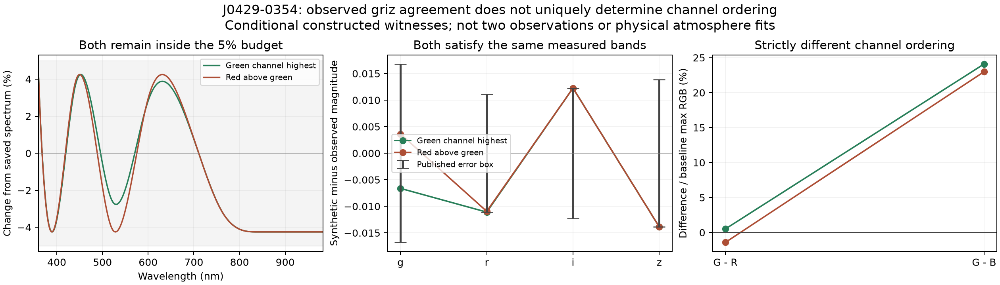
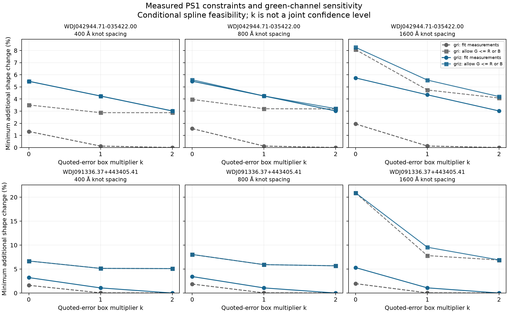
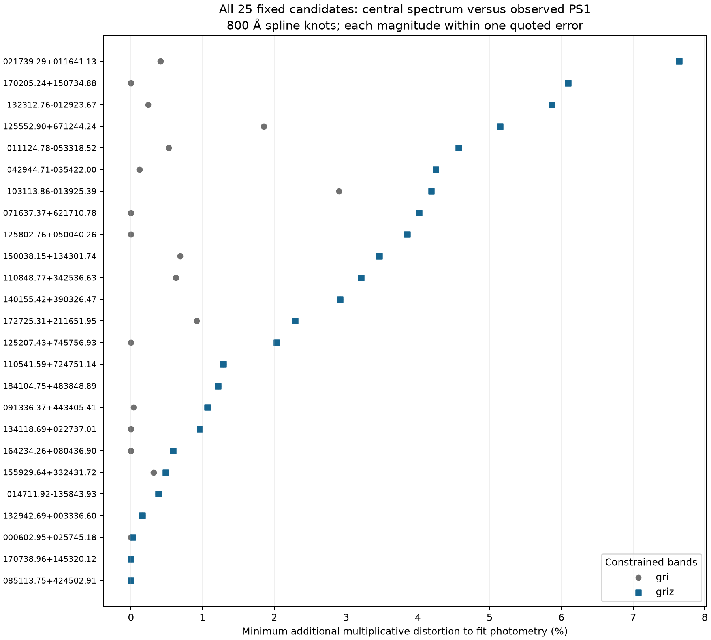

# 実測測光を拘束した色判定の識別可能性

2026-10-19 UTC。Shota Moriwaki の研究プロジェクトにおける、ChatGPT支援の探索的・未査読解析。

**J0429−0354では、観測PS1 grizの各誤差範囲に入る、緑チャンネル優位と赤チャンネル優位の両方のスペクトル形状を実際に構成できました。** どちらも保存済みの基準スペクトルからの変形は最大約4.25%です。これは指定した滑らかな補正空間での識別の限界を示します。補正が実際に起きた確率や、星の本当のスペクトルを測定した結果ではありません。



## 入力と、前回の試験との違い

単位確認済みのDESIを観測PS1 griへ較正した、[固定の初期候補集合](../precision/candidate_recalibration/derivative_manifest.json)の全25スペクトルを用います。初期27対象のうち、外部測光が利用できない2対象も[結果JSON](feasibility_results.json)の `unavailable_entities` に理由付きで残します。25は現在の最終候補全数や無作為標本ではありません。

前回の[零空間試験](../precision/photometric_nullspace.json)は、基準スペクトル自身の合成gri光束を厳密に保存しました。今回は**カタログに掲載された実測等級**を使い、各測光の許容範囲とz追加の効果を直接調べます。拘束条件が違うので、両実験の境界到達量が異なることは計算の不一致ではありません。

Swan公表PS1誤差には0.01 magの二乗和の底上げが既に含まれています。今回、同じ項を再度追加していません。保存済み基準スペクトルの較正に使った `max(公表誤差, 0.02 mag)` と、今回の誤差範囲の定義も区別します。[測光誤差の原定義](../literature/swan_photometry_definition.md)

## 再現可能な問題設定

波長ごとの相対変化を三次Bスプラインで表します。

\[
f_{\mathrm{new}}(\lambda)=f_0(\lambda)[1+s(\lambda)],\qquad
s(\lambda)=\sum_j a_j B_j(\lambda).
\]

目的は、各天体で残ったスペクトルの**全波長域（3600 Åから約9820–9824 Å）**における最大変形

\[
t=\sup_\lambda |s(\lambda)|
\]

を最小化することです。上限を0.95とし、倍率は全域で0.05以上に保ちます。元の有限な負フラックス画素は残すので、「全画素を正にしたスペクトル」という意味ではありません。既存の有限値・正IVAR条件と狭い空輝線マスクを適用し、各XYZ積分も基準の正値の10⁻⁸以上となるよう拘束します。

使用帯域ごとに、公表等級と誤差を `m_b, σ_b` として

\[
m_b-k\sigma_b\leq m_{\mathrm{synthetic},b}\leq m_b+k\sigma_b
\]

を課します。maggiesへの変換後の下限は `10^[-0.4(m_b+kσ_b)]`、上限は `10^[-0.4(m_b−kσ_b)]` です。フィルター積分は元の符号付きフラックスに対して線形なので、スプライン係数への線形制約として解けます。specliteの実際のPS1応答と光子数で重みを付けたAB測光を使用し、応答配列のSHA256も保存しました。[specliteの一次資料](https://speclite.readthedocs.io/en/latest/api/speclite.filters.FilterConvolution.html)

実験の組合せは次の通りです。

| 設定 | 固定した値 |
|---|---|
| 候補 | 利用可能な25対象を全て保持 |
| スプライン節点間隔 | 400 / 800 / 1600 Å |
| 測光拘束 | gri / griz |
| 各公表誤差の倍率k | 0 / 1 / 2 |
| 1設定あたりの目的 | 測光のみ、G≥RかつG≥B、G≤R、G≤B |
| 設定数・線形計画数 | 450設定・1800問題 |

G、R、Bはクリップ前の線形sRGBチャンネルです。「非緑側」は `G≤R` と `G≤B` の和集合なので、二つの線形計画の小さい方を採用します。境界の同値点は双方の閉領域に属します。そのため、境界に触れる解から厳密な緑優位を主張しません。以下のJ0429の具体例では、正負それぞれに余裕を持つ制約を追加しました。

kは各帯域の箱型拘束の倍率です。共同の信頼水準、独立誤差の仮定、共分散のモデルではありません。k=0はカタログ中央等級への厳密な一致であり、真値の既知性を意味しません。**grizを使う設定ではzもfitに使用済み**なので、そのz残差を未使用データへの予測精度とは呼べません。

## 数値解の確認

最初は8 Å間隔と節点で変形上限を拘束し、解のスプラインの導関数の根を全て求め、その極値の波長を反復追加しました。最終的な連続最大値と線形計画の目的値の差を確認します。HiGHSの一次・双対許容誤差は10⁻¹⁰、最大120反復です。[HiGHSの公式API資料](https://docs.scipy.org/doc/scipy/reference/optimize.linprog-highs.html)

結果は1772の実行可能解と、指定95%上限内での28の実行不能判定でした。実行可能解は全て、保存した線形計画行列を使わず、元のフィルターと色一致関数から再積分しています。

| 検証 | 結果 |
|---|---:|
| 連続最大値とLP目的値の最大差 | 1.9912×10⁻⁹（相対変形の単位） |
| 再積分した測光の箱型拘束の最大超過 | 2.6345×10⁻⁹ mag |
| 制約の包含関係に関する検算 | 3450条件すべて一致 |
| 別の確認処理による0.5 Å密格子の検算 | 全1772解。保存最大値を超えた最大量3.47×10⁻¹⁸ |

包含関係は、zを追加して最小必要量が減らないこと、誤差範囲を広げて必要量が増えないこと、色の制約を追加して必要量が減らないことを確認しました。これらは浮動小数点計算での検証であり、区間演算による厳密な最適性証明ではありません。実行不能解にも独立したFarkas証明書は付けていません。「95%以内の指定空間で解けない」を、実在の星がその色を持てないという物理的結論へ置き換えません。

## 主要2対象：測光に合うための変形と、判定が変わる変形

節点800 Å、k=1での最小最大変形です。基準は保存済みのgri較正スペクトルです。

| 対象 | griに整合 | grizに整合 | griに整合し非緑側へ到達 | grizに整合し非緑側へ到達 |
|---|---:|---:|---:|---:|
| J0429−0354 | 0.121% | **4.249%** | 3.198% | **4.249%** |
| J0913+4434 | 0.034% | **1.068%** | 5.926% | **5.927%** |

J0429のzは、前回のgri較正スペクトルから予測すると−0.06098 magずれていました。今回、その実測zも満たすようにすると、約4.25%の形状変形が必要になります。その大きさの変形を認めると、緑／非緑側の両方が許容される、という具体的な事情が分かりました。新たな物理スペクトルを得たという意味ではありません。

J0913では、grizに合わせるための必要量は約1.07%ですが、非緑側の境界までには約5.93%を必要とします。同じ条件ではJ0429よりチャンネル順序が頑健です。ただし400 Å空間では約5.14%、1600 Å空間では約9.56%になり、モデル空間への依存は残ります。節点間隔は実測の装置誤差相関長ではありません。



3列の図は同じ対象の行内で縦軸を共有し、最大値を全列から求めています。大きな値が右端パネルで切れる表示上の問題を修正して、最終図を実際に開いて確認しました。

## J0429の厳密に異なる二つの具体例

節点800 Å、観測grizの各公表誤差範囲、同じ5%変形予算を固定しました。緑側には `G−R` と `G−B` が基準RGB最大値の0.005以上、反対側には `R−G` が同じ基準の0.005以上という条件を課しています。

| 構成した解 | 連続最大変形 | 得られた表示色 | 実際のチャンネル順序 |
|---|---:|---|---|
| 緑チャンネル優位 | 4.249241% | #FEFFE1 | G>R かつ G>B |
| 赤チャンネル優位 | 4.249223% | #FFFDE1 | R>G |

[係数・測光残差・色度JSON](contrasting_witnesses.json)と[波長別配列NPZ](J0429_contrasting_griz_witnesses.npz)から追試できます。表示色はどちらも淡色で、16進値の細かな差を人間の知覚判別の保証としていません。この例は、同じ四帯域に整合するだけでは指定したチャンネル順序を一意に決められないことを示します。

## 全25対象での較正予算の点検

節点800 Å、k=1では、測光に合う最小最大変形の中央値はgriのみで0.241%、grizで2.286%でした。grizでの最大は7.637%です。

| grizに対する仮の最大変形予算 | 測光に整合する解なし | 非緑側のみ | 緑側閉領域のみ | 両閉領域に解あり |
|---|---:|---:|---:|---:|
| 2% | 14 | 10 | 1 | 0 |
| 5% | 4 | 15 | 1 | 5 |
| 10% | 0 | 19 | 0 | 6 |

「14/25が2%以内では四帯域に合わない」は、実行済みの条件付き診断です。装置の誤差が実際に2%である、14対象の測光が誤りである、14個の新しい物理現象を発見した、という意味ではありません。較正関数だけに原因を押し込めず、測光の時期、近傍、吸収帯、測光系の誤差、スペクトル欠損も検討する必要があります。



## 学術的に次に問うこと

この研究の次の測定可能な目標は、標準星・同じ星の反復観測・同時測光から現実の較正変動を推定し、その許容集合の中で色判定と元素領域の予測が残るかを調べることです。任意の5%を現実の確率分布へ読み替えず、実測した波長相関・装置間の共通誤差・選別効果を接続します。

その上で、局所吸収帯を持つ大気モデルと滑らかな較正変形を同時に比較し、fitに使わなかった波長域で予測を検証します。同じスペクトルから計算した色を、そのスペクトルと独立の観測として尤度へ足しません。[公開モデルとの実比較](../model_validation/README.md)

## 再生成

依存環境を用意した後、リポジトリ直下で実行できます。配列・フィルター以外のネットワーク取得は不要です。

```bash
python research/calibration_followup/photometric_feasibility.py
python research/calibration_followup/contrasting_witnesses.py
python scripts/verify_research_followup.py --group calibration
```

元の候補値・旧零空間実験を上書きしません。[全450設定CSV](feasibility_summary.csv)には全候補・全条件を残し、都合の良い解だけを掲載していません。
