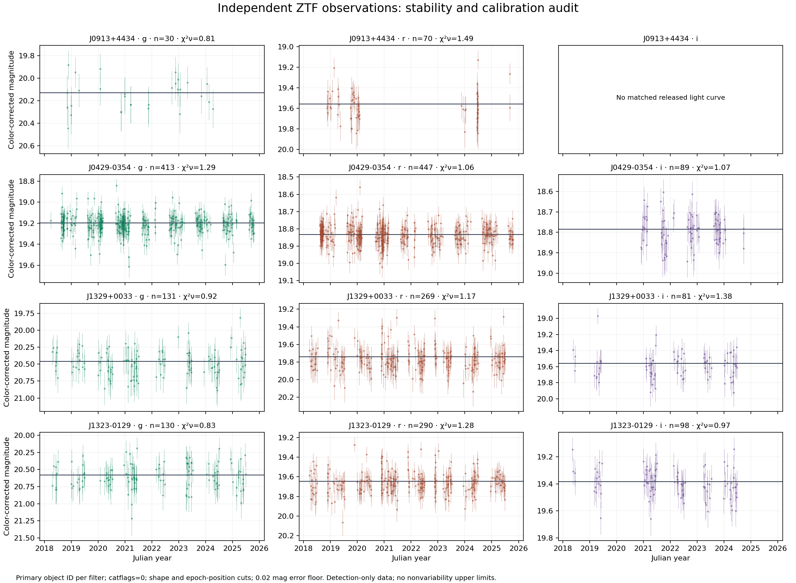
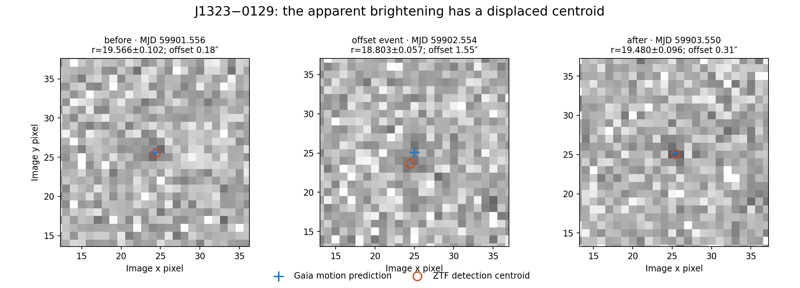

# External observational validation: time dependence and field quality

**Acquired and analysed:** 18 October 2026 UTC.
**Status:** Reproducible exploratory audit; no new variable star, transient,
atmospheric mechanism, or discovery priority is established here.

This extension tests two assumptions behind the colour search: that spectra
and broadband calibration points describe the same source, and that their
different observation dates do not conceal substantial variability. It adds
**ZTF DR24 observations**, plus a direct **ESA Gaia DR3** quality and field check
of the **27 objects** provisionally retained by the full-spectrum audit.

## What changed scientifically

### 1. Four principal candidates now have an independent time-domain check

We acquired 17 source-associated ZTF light curves containing **2,473 exposure
records**, and 18 nearby comparison-star light curves with **4,646 records**.
After shape, flag, and observation-epoch positional checks, **2,327 candidate
records** remain. No duplicate candidate exposure keys were found across the
selected object IDs. ZTF provides a separate telescope and observing epochs;
its absolute photometric calibration is tied to PS1, and our colour correction
uses the existing PS1 anchors. Thus this is an additional **time-domain
observation**, not independent absolute colour calibration. The products and
calibration convention are documented in the [ZTF DR24 release notes][ztfdr24]
and [ZTF explanatory supplement][ztfsupp].

For each filter, the principal curve below is the matching object ID with the
most accepted points. Light curves from different fields or CCD quadrants are
kept distinct rather than spliced with an assumed common zero point.

| Candidate | Main r-band records after cuts | Main r-band reduced χ² | Common-exposure differential r records | Differential reduced χ² |
|---|---:|---:|---:|---:|
| J0913+4434 | 70 | 1.490 | 67 | 0.824 |
| J0429−0354 | 447 | 1.057 | 444 | 0.872 |
| J1329+0033 | 269 | 1.171 | 260 | 0.669 |
| J1323−0129 | 290 | 1.278 | 286 | 0.877 |

Numbers are calculated in [the full audit](results/ztf_audit.json) and
[the main-curve table](results/primary_lightcurve_summary.csv). Measurements
span portions of 2018–2025. The comparison-star calculation retains exposures
with at least two selected comparison detections. Its errors include their
uncertainty, so a lower differential χ² is **not by itself proof that an
instrumental signal has been removed**. The JSON includes the uncorrected
series with the same total errors, an alternative without control colour-term
regression, and all leave-one-comparison-star-out results.

These data do not establish stellar variability for the four principal
candidates. They also **do not establish constant flux, constant spectral
shape, or a quantitative upper limit on undetected variability**. The catalogue
contains detections, not forced measurements in every image. Faint-source
censoring, incomplete temporal coverage, and survey systematics are documented
by [ZTF][ztfcautions]. There is no period search or injection/recovery analysis
in this extension.



### 2. A seemingly clean J1323 brightening fails the epoch-position check

The r-band record at **MJD 59902.554433, 19 November 2022** has
`catflags=0`, native magnitude **18.803±0.057**, and superficially acceptable
PSF shape metrics. The nearest accepted visits before and after have
**19.566±0.102** and **19.480±0.096**. Calling the event a roughly 0.7 mag white
dwarf flare from magnitude and catalogue flags alone would be premature.

The detection is **0.775 arcsec** from the unpropagated Gaia 2016 position, but
**1.549 arcsec** from the Gaia position propagated to the exposure date. The
before/after positions are only **0.180/0.315 arcsec** from their respective
predictions. The event therefore fails the predeclared 1.5 arcsec association
cut. Its exact record is retained, including the rejection reason, in
[all epoch decisions](results/target_epoch_decisions.csv.gz).

We downloaded the original 50 arcsec science-image cutouts for the three
visits and inspected the plotted centroids. The image evidence is sufficient
to inspect the positional inconsistency but **does not identify the cause**.
A blended moving or transient source, a biased PSF centroid, and an extraction
or image artifact remain possible. No PSF subtraction, moving-object ephemeris
association, or independent transient confirmation has been performed. See
the [numerical/image audit](results/J1323_offset_event_review.json), preserved
FITS files, and [official ZTF cutout interface][ztfapi].



This is a useful method result: **a clean catalogue flag plus a fixed catalogue
position can admit a misleading time-series outlier in a moving white dwarf**.
The event is flagged rather than erased or assigned an unsupported physical
explanation.

### 3. The 27-object shortlist includes a known variable and bright neighbours

All **27 exact Gaia DR3 source IDs** were returned by the ESA archive. Four
batched 10 arcsec field queries returned 30 distinct Gaia sources. All target
RUWE values are below the diagnostic value 1.4; that does not certify clean
photometry. The complete per-object results are in
[gaia_extended_quality.csv](results/gaia_extended_quality.csv).

**Gaia DR3 1245262790370992256** is already classified `VARIABLE`. Its public
`vari_summary` gives **44 selected G-band field-of-view transits over 906.783
days**, a full magnitude range **0.779294 mag**, trimmed range **0.626015 mag**,
and standard deviation **0.183683 mag**. The variability classifier supplies
the automatic label **CV**, score **0.6277259**. This is a previously published
catalogue classification, not a newly discovered variable or a confirmed
physical CV identification. Gaia's score is a normalized classifier-rank
summary, not a 62.8% posterior probability. The [classifier][gaiacls] and
[summary][gaiasummary] documentation define these fields; the exact queried
rows and provenance are in `raw/gaia_dr3_variable_candidate_*.csv` and the
matching JSON files.

For this object, a colour inferred by combining noncontemporaneous spectra
and mean photometry requires a phase-dependent treatment. The stable-SED
assumption is not defensible without additional observations or modelling.

Three shortlist targets have catalogued Gaia neighbours within 10 arcsec:

| Target Gaia source ID | Neighbour Gaia source ID | Separation at 2016 | Neighbour/target G flux ratio | Linear separation at 2026 |
|---|---|---:|---:|---:|
| 1182083542272959232 | 1182083546568484736 | 9.908″ | 11.30 | 8.531″ |
| 761677269868775040 | 761677201149496704 | 9.268″ | 417.90 | 9.038″ |
| 818833831355548928 | 818833831355548800 | 5.342″ | 0.895 | 4.726″ |

The first two are additional reasons to inspect PSF wings, sky subtraction,
slit/fibre placement, and exposure-specific seeing. These geometric and
broadband-flux values are **not estimates of actual contaminating spectral
flux**. The [neighbour table](results/gaia_extended_neighbours.csv) retains the
astrometry. The remaining 24 fields having no additional Gaia record does not
exclude unresolved stars, galaxies, or fainter uncatalogued sources. The one
legacy positional alias association is separately flagged; its small present
coordinate offset does not replace an epoch-aware identity audit.

## Analysis choices and practical limits

1. **Exact identifiers and release.** Gaia IDs remain strings. The public
   IRSA TAP inventory confirmed DR20–DR24; DR24 was requested explicitly.
   A slow positional light-curve query was replaced with public TAP object
   identification followed by direct object-ID downloads. Failed requests
   are saved as acquisition diagnostics and never treated as empty fields.
2. **Position and quality.** Gaia proper motions are propagated with their
   correct `pmra = μα cos δ` convention. Selection uses `catflags=0`, finite
   positive errors, `0 < chi < 3`, `abs(sharp) < 0.5`, and separation below
   1.5 arcsec from the exposure-epoch prediction. Cuts at 0.5 and 1.0 arcsec
   are also reported. No magnitude outlier clipping enters the main result.
   A separately labelled top-1% diagnostic shows sensitivity to a few points.
3. **Colour term and errors.** For g/r, `m_corrected = m + clrcoeff*(g-r)_PS1`;
   for i, the PS1 r−i colour is used. A 0.02 mag error floor is added in
   quadrature as an assumption. It is not a measured universal systematic
   floor. These transformations do not justify replacing DESI calibrations
   with ZTF magnitudes for unusual spectral energy distributions.
4. **Comparison stars.** Up to five nearby r-band sources were selected by
   field/CCD/quadrant, proximity, ±0.35 mag brightness, minimum released
   observations, and reference-image shape, **without selecting low
   variability**. Three were available for J0429 and five for each other
   target. We remove a fitted nuisance dependence on colour coefficient
   before taking their same-exposure median residual. The fitted coefficient
   is not interpreted as a physical control-star colour. The alternative
   using mean-centred controls without that regression is also retained.
5. **Inference.** Quoted χ² p values assume independent Gaussian errors and
   are diagnostic, without correction for examining multiple stars/bands.
   Extra-scatter fits are descriptive and not intrinsic stellar amplitudes.
   Comparison-star stability, exact epoch covariance, and detection
   completeness are not established. Parallax and perspective terms are
   omitted from the small-radius identity propagation; the four parallaxes
   are below 0.013 arcsec, much smaller than the tested matching radii.

## Research paths supported by the new evidence

The first priority is an **epoch-aware measurement audit**: forced photometry
at moving Gaia positions, image- and PSF-level checks on displaced epochs, and
appropriate exposure-level controls. This can test whether the J1323 event
is an unrelated source or a measurement issue without mistaking it for a
white dwarf flare.

The known-variable shortlist object motivates **phase-dependent chromaticity**:
obtain same-epoch multiband photometry and spectra, then ask whether its CIE
position changes with rotation, pulsation, or accretion state. The Gaia CV
label is a hypothesis cue, not a mechanism measurement. Its original spectral
classification and source identity require independent literature review.

The two bright-neighbour cases motivate an **aperture and seeing sensitivity
test**. A reproducible forward model could inject the measured neighbour SED
through the actual fibre/slit and seeing profiles, propagate subtraction
uncertainty into CIE space, and decide whether the unusual colour survives.
A Gaia G-band ratio alone cannot perform that test. These are concrete next
experiments justified by observed failure modes; they are not reported as
completed experiments or new astrophysical mechanisms.

## Files, provenance and reproduction

All successful raw responses carry their exact public URL, query parameters,
retrieval UTC, byte count and SHA-256 in adjacent `*.provenance.json` files.
The 27-object input is frozen with its parent-table hash. No private archive,
login, forced-photometry job submission, or private data was used.

| File or directory | Purpose |
|---|---|
| `raw/` | Narrow Gaia/IRSA catalogue responses, 35 ZTF light curves, three small original science cutouts, and acquisition metadata |
| `ztf_object_selection.json`, `control_selection.json` | Exact target/control selections, including rejected catalogue IDs |
| `gaia_extended_input.csv` | Frozen exploratory 27-object input, not a discovery catalogue |
| `results/ztf_audit.json` | All per-ID, per-band, control and sensitivity results |
| `results/target_epoch_decisions.csv.gz` | Every target observation with position/quality decisions; rejected points remain visible |
| `results/differential_r_epochs.csv.gz` | Same-exposure comparison-star residuals and propagated errors |
| `results/epoch_outliers_for_image_review.csv` | Five most discrepant retained points per primary band, an inspection queue rather than accepted transients |
| `results/gaia_extended_*.csv` | Complete source-quality and neighbour results for all 27 IDs |

From the repository root, using an environment with NumPy, SciPy, pandas,
Matplotlib and Astropy (the project's core dependency set):

```bash
python research/external_validation/verify_frozen.py
python research/external_validation/analyze_ztf.py
python research/external_validation/gaia_extended.py
python research/external_validation/review_offset_epoch.py
```

The supplied raw inputs make these computations offline once their source
files are present. For an incomplete checkout,
`python research/external_validation/verify_frozen.py --fetch-missing` replays
the exact saved queries. Changed upstream bytes are preserved separately and
fail verification; they are never silently substituted. If rerunning the
original acquisition, `acquire.py` and `acquire_ztf.py` document the staged
query and selection logic, and every ad hoc metadata query is retained in
its exact provenance file.

The new inputs are third-party survey data, not newly licensed by this
repository. Credit **ZTF**, the Samuel Oschin Telescope at Palomar Observatory,
**Caltech/IPAC**, **NASA/IPAC IRSA**, and **ESA/Gaia/DPAC**. Preserve provider
terms, release citations, and required publication acknowledgments via the
[ZTF DR24 instructions][ztfdr24] and the project's
[data availability policy](../../docs/data-availability.md). The original
survey-data provenance is distinct from our selection, analysis and plots.

## 日本語の要点

- ZTFという別望遠鏡の公開時系列を実際に取得し、主要4候補の2,473測定と
  近傍対照18星の4,646測定を解析した。ZTFの絶対校正はPS1とつながるため、
  完全に独立した色校正として数えていない。
- J1323の約0.7等増光に見える1点は、品質フラグが正常でも、固有運動を
  観測日時まで補正すると位置が1.55秒角ずれる。原画像3枚も点検したが原因は
  未確定。恒星フレアと呼ばず、元データと除外理由を残した。
- 追加候補27天体をESA公式データで一件ずつ照合。1天体はGaiaで既に変光天体。
  自動分類CVのスコアを「CVである確率」と解釈しない。時期の違うスペクトルと
  平均測光を安易に組み合わせるべきでない対象として分離する。
- 別の2候補には、10秒角以内にG光量で約11倍／418倍の明るい近傍がある。
  分光の混入量はまだ測定できていないため、追加観測やPSFモデルが必要。
- 主要4候補の新たな恒星変光は確立しなかった。ただし短い現象・小さい変動の
  不在や、色の完全な不変性を証明したわけではない。今回の成果は、新発見の
  主張を増やすことより、誤同定・変光・混入を具体的な証拠で扱える点にある。

[ztfdr24]: https://irsa.ipac.caltech.edu/data/ZTF/docs/releases/dr24/ztf_release_notes_dr24.pdf
[ztfsupp]: https://irsa.ipac.caltech.edu/data/ZTF/docs/ztf_pipelines_deliverables.pdf
[ztfcautions]: https://web.ipac.caltech.edu/staff/fmasci/ztf/extended_cautionary_notes.pdf
[ztfapi]: https://irsa.ipac.caltech.edu/docs/program_interface/ztf_api.html
[gaiacls]: https://gea.esac.esa.int/archive/documentation/GDR3/Gaia_archive/chap_datamodel/sec_dm_variability_tables/ssec_dm_vari_classifier_result.html
[gaiasummary]: https://gea.esac.esa.int/archive/documentation/GDR3/Gaia_archive/chap_datamodel/sec_dm_variability_tables/ssec_dm_vari_summary.html
