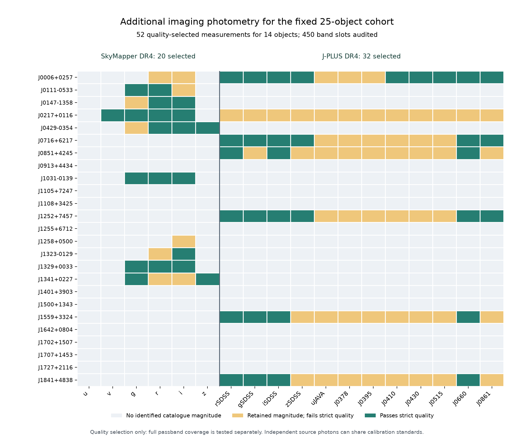

# 別の望遠鏡で得た測光による追加検証

固定した初期候補のうち、前段の PS1 再較正スペクトルがある **25 天体**をそのまま照会した。SkyMapper DR4 と J-PLUS DR4 の実際の撮像測光を取得し、**14 天体・52 測定**を厳格な品質条件で採用した。これは新しい白色矮星の発見数ではない。測定値を既存スペクトルの予測と比較し、較正の自由度を減らすための観測情報である。

| 調査 | 対象の行が位置・IDとも整合 | 厳格品質で測定を採用した天体 | 採用バンド測定数 |
|---|---:|---:|---:|
| SkyMapper DR4 | 10 | 8 | 20 |
| J-PLUS DR4 | 7 | 6 | 32 |
| 両調査の和集合 | 15 | 14 | 52 |

SkyMapper の 6 バンド、J-PLUS の 12 バンドについて **25 × 18 = 450 枠**を作り、欠測・対応不成立・品質不採用も残した。S-PLUS の照会失敗は別表に保存し、未検出として数えていない。[summary.json](summary.json)、[全25天体のcoverage.csv](coverage.csv)、[全測定のmeasurements.csv](measurements.csv) が数値の出典である。



図の短い J 座標名は Gaia の ICRS 位置から表示用に生成した。機械照合の主キーは、丸めない十進文字列の `source_id` である。CSV の `name` は以前の標本定義の表示名を保持している。

## 取得した測定と原本

SkyMapper は `dr4.master` の PSF 等級を使う。対応する **110 件の個別検出**も `dr4.photometry` と `dr4.images` の公開結合照会で取得し、使用・棄却、マスク、露出時間、観測 MJD、FWHM を確認した。主採用測定の露出は 2014-08-31 から 2021-09-14 までを含む。各バンドの平均が同じ夜を表すとは限らない。

J-PLUS は `jplus.MagABDualObj` の **3 arcsec 直径の aperture-corrected AB 等級**を使う。PSF フィット測光とは呼ばない。r バンドで検出した位置で各バンドを測る dual mode の値である。7 対象の全 12 バンドについて、元の `FNuDualObj` の値と coadd を構成する撮像日時も取得した。主採用測定の露出は 2017-07-31 から 2024-12-25 までを含む。r バンドの coadd 日時の平均を対象位置照合の代表 epoch にし、各バンド自身の最初・最後の撮像日時を別に保存した。[J-PLUS の公開表定義](https://archive.cefca.es/catalogues/jplus-dr4/adql_help_table?db=J-PLUS-DR4&name=jplus.MagABDualObj)、[3 arcsec の定義と測光手法](https://arxiv.org/html/2509.21304v1#S2.SS1) を参照。

`raw/` には公開応答を加工せず保存した。全応答の URL、照会引数、取得 UTC、HTTP status、SHA-256 は対になる `*.provenance.json` に、ADQL は `queries/` にある。[source_manifest.json](source_manifest.json) は原応答・provenance・query・上流2入力をまとめる。先行する失敗照会も保持し、HTTP 200 の VOTable `QUERY_STATUS=ERROR` を正常な空表に変換しない。

本解析は消光補正を追加していない。観測スペクトルとの比較では、各調査の実際の応答関数を通した予測が必要になる。SkyMapper g と PS1 g のように同じ文字のバンドでも、等級の直接差をスペクトル残差とは扱わない。

## 対応星を取り違えない照合

出発点は既に固定された `candidate_recalibration/derivative_manifest.json` の25件であり、今回の測光が見つかるかどうかで母集団を変更していない。Gaia DR3 の元位置・基準 epoch・`pmra`・`pmdec` を使い、半径 15 arcsec の公開 catalogue 検索を全件実施した。`pmra` は赤経方向の移動に `cos(dec)` を含む。最終採用には、**公刊 Gaia ID の一致と、観測 epoch に移した位置から 1 arcsec 以内**の両方を要求した。平均カタログ位置に年周視差を重ねて適用せず、半径方向速度も仮定していない。

33 行のカタログ候補のうち17行を対応星とし、16行を別星・対応不成立として残した。次は実際に検出した取り違えの例である。[identity_audit.csv](identity_audit.csv) に全行と根拠がある。

| 固定候補の Gaia DR3 ID | 採用しなかったカタログ行 | 確認した理由 |
|---|---|---|
| `1182083542272959232` | SkyMapper `2421604951` | 最近傍 Gaia は別星。対象は約9.85″離れた第2近傍として掲載されるだけだった。 |
| `4545191991882663936` | SkyMapper `2427456996` | 最近傍 Gaia は別星。対象との生の位置差は約12.89″だった。 |
| `3638333660492606976`（J1323−0129） | SkyMapper `107990965` | 最近傍 Gaia ID は対象と一致するが約12″離れた別の撮像源。ID一致だけでは採用できない。正しい行は `107990969`。 |
| `761677269868775040` | J-PLUS `190232:15354` | 公刊 Gaia 結合先は明るい近傍 `761677201149496704`。対象の測光に転用しない。 |

同じ 15 arcsec を持つ Gaia DR3 周辺領域も25件すべて新たに照会した。30行の Gaia 原カタログを得て、5件の近傍を [gaia_neighbour_audit.csv](gaia_neighbour_audit.csv) にまとめた。J0429 にはこの領域内に別の Gaia 行がない。Gaia G の明るさ比は、別のフィルターでの混入率ではない。PSF の翼、カタログにない低信号源、マスクの外の明るい星まで除外できたという意味にはしない。

## 残差を見る前に決めた品質条件

どちらも誤差は有限・正で、後述する推奨誤差が **0.1 mag 以下**のものを主採用とする。これは本検証の精度条件であり、調査全体の検出限界ではない。色、予測残差、期待する緑色への近さを品質選択に使っていない。

**SkyMapper:** master の good 検出と clipped mean に実際に残る露出がともに2件以上、当該バンドの source flags とマスク画素数が0、使用された全個別露出でも両者が0、当該バンドの `flags_psf` bit が0、を要求する。`ngood - nclip` が、取得した `use_in_clipped=1` の個別検出数と一致することも検証する。`flags_psf` は近傍からの PSF 測光バイアスに関する調査側の診断であり、ここで新しい PSF 模型を当てはめたものではない。[公式の品質・既知問題](https://skymapper.anu.edu.au/data-release/)、[列定義](https://skymapper.anu.edu.au/table-browser/dr4/) を用いた。

SkyMapper の公式 good 条件は source flags `<4`、マスク画素数 `<5` を許す。本実験の厳格条件より緩いこの条件に、同じ位置・露出数・精度条件を加えた補助判定が `official_good_sensitivity` である。主採用の `adopted` を上書きしない。

**J-PLUS:** source flags、mask flags、tile flags、既知変光 flags が0、対応する single-band detection が存在、相対 weight が0.8以上、coadd の露出数が2以上、とした。`mask_flags=2` は **bright-star mask** を意味する。`2513256394506328832` の全 J-PLUS バンドはこの理由で主採用しない。近くに明るい星がなく見えるという理由だけで、調査側の mask を解除しない。[公式 flag 定義](https://archive.cefca.es/catalogues/jplus-dr4/adql_help_table?db=J-PLUS-DR4&name=jplus.MagABDualObj) を原 HTML とともに保存した。

両調査で別 aperture の値も診断用に保持した。採用した J-PLUS の3″補正値と6″補正値の差が最大約0.228 magの例がある。大きい aperture の誤差や相互の共分散を無視した有意度を付けず、混入・背景・aperture correction を調べるための情報として残す。カタログ flags とこの比較だけで画像レベルの混入が完全に解決したとはしていない。

## J0429−0354 の具体例

`3204436719718449280` は SkyMapper `24884480` と一致し、固有運動補正後の位置差は約 **0.087 arcsec**。個別露出18件のうち、17件がカタログ平均の計算に残る。10秒の低品質 i 検出には flag 512 があり、調査自身が平均から除外している。

| SkyMapper band | カタログ PSF AB等級 | 公刊誤差 | good露出数 | 本解析 |
|---|---:|---:|---:|---|
| g | 19.1114 | 0.0172 | 4 | 補助感度ケース。使用された1露出にマスク4画素があり厳格条件では不採用。 |
| r | 18.8450 | 0.0181 | 5 | 主品質採用。 |
| i | 18.7919 | 0.0197 | 6 | 主品質採用。 |
| z | 18.6842 | 0.0581 | 2 | 測光品質は採用。スペクトルの赤端より広い応答関数を完全に積分できないため、現スペクトルへの追加制約には使わない。 |

u/v の測定はない。SkyMapper z の波長を途中で切ったり、スペクトルを外挿して z を計算したりしていない。主 r/i と、ラベルを分けた補助 g の制約評価は [measurement_design/MEASURED_DESIGN.md](../measurement_design/MEASURED_DESIGN.md) に分離している。J0913 は今回の両調査に対応測光がなく、追加検証が得られたとは扱わない。

## 観測の独立性と較正の相関

取得したのは対象星を SkyMapper / JAST80 が別に撮像した測光であり、対象の Gaia XP スペクトルから新たに作った合成等級ではない。一方、**独立な光子観測と、独立な絶対較正は別の性質**である。

SkyMapper DR4 は Gaia DR3 XP に基づく標準星を零点較正に利用する。公式説明は CALSPEC との比較や u/v の応答関数の波長ずれの可能性も記述する。J-PLUS DR4 の `calibration_method=13` は補正 Gaia DR3 XP / BEST 標準星による初期較正であり、その上に白色矮星の色 locus と PS1 r による絶対 anchor を適用している。このため Gaia、PS1、白色矮星の色分布との共通系統誤差や、較正に用いた色分布への依存が残る。

J-PLUS `jplus.Filter` の定義は、`abs_zp_offset` が **画像と測光へ既に適用済み**であることを明記している。ここでは再加算しない。`abs_zp_offset_err` は、著者の指示通りに測光誤差へ二乗和で加える。

\[
\sigma_{m,\,\mathrm{recommended}}=
\sqrt{\sigma_{m,\,\mathrm{catalogue}}^2+
\sigma_{\mathrm{absolute\,ZP}}^2}.
\]

この零点成分はバンドにより約0.005–0.0077 magで、共通の PS1 r anchor の5 mmagも含む。したがって各バンドの誤差を統計的に独立な Gaussian として扱える、という情報ではない。SkyMapper には本解析独自の誤差 floor を加えていない。

CSV/JSON には `mag_error_quoted`、`zeropoint_error_to_add`、**`mag_error_with_zeropoint`** を分けてある。後続の制約には最後の列を使う。誤差箱の幅を変える感度解析は、較正誤差や共分散を推定した結果とは区別する。[公式零点・誤差定義](https://archive.cefca.es/catalogues/jplus-dr4/adql_help_table?db=J-PLUS-DR4&name=jplus.Filter)、[公式較正 method の説明](https://archive.cefca.es/catalogues/jplus-dr4/adql_help_enum?db=J-PLUS-DR4&name=calibration_method) が根拠である。

J-PLUS の独立した Fν 形式のカタログ応答から、全84バンドの AB 等級と誤差を再計算した。等級の最大差は **5.03×10⁻⁵ mag**、相対 flux error から求めた等級誤差の最大差は **4.96×10⁻⁵ mag**で、公開表示値の丸め幅と整合する。Fν の表単位 `10^-30 erg s^-1 cm^-2 Hz^-1` を確認しており、Fλ と混同しない。

## 既知の外れ値分類との照合

[López-Sanjuan et al. 2025, A&A 701, A273](https://doi.org/10.1051/0004-6361/202555286) は J-PLUS DR3 の白色矮星を H/He モデルで解析し、残差を使った UMAP で外れ値を分類済みである。今回の追加測光を「外れ値分類という方法の新発見」とはしない。

CDS 原公刊表には Gaia ID 列がないため、**Gaia DR3 ID → J-PLUS DR3 `(TILE_ID, NUMBER)` → CDS の同じ2列**で結合し、丸められた公刊位置も確認した。25位置すべての別の CDS cone 照会とも一致する。

| 天体 / Gaia ID | 公刊 Typeout | 公刊 χ² | 公刊 pCa | 解釈 |
|---|---:|---:|---:|---|
| J0006+0257 / `2739231150982741760` | 2 | 554.12 | 1.000 | 既知の metal-polluted 群。公刊 EW(J0395) は75.02±6.43 Å。 |
| J1252+7457 / `1691957732959636608` | 1 | 54.77 | 0.186 | 著者が random-fluctuation 群と解釈した外れ値。金属がないことの証明ではない。 |
| J1841+4838 / `2119909923600264960` | 0 | 22.15 | 0.168 | この公刊モデル検査では外れ値に該当しない。 |

[prior_classifications.csv](prior_classifications.csv) は残り22件にも欠測理由を記録する。未対応を正常スペクトルと分類しない。公刊表の rmag は**モデルから得た消光補正済みの総等級**であり、今回の追加観測点へ混ぜていない。pCa は大気モデルによる連続光予測と事前分布に依存する。DR3 と DR4 の異なる release 名だけで、同じ撮像を独立観測として数えることもない。

## S-PLUS の現状

SkyMapper の公式 public TAP は `ext.splus_dr3` を掲載し、`SELECT TOP 1 *` は実際に12バンドの値と品質列を返した。しかし、25位置の検索ではサーバーが返すヘッダ通りの `ra` / `dec` を「Unknown column」として拒否した。小文字・大文字の引用識別子と table alias を使う矩形 `BETWEEN` 条件でも失敗し、`TAP_SCHEMA.columns` の同表の列一覧は空だった。

これは公開ミラーの列解決に関する照会失敗であり、対象が観測されていない証拠ではない。[splus_access_audit.csv](splus_access_audit.csv) に25件を **ERROR / 未検出かどうか不明**として残す。公式 S-PLUS の会員用データ経路から取得した値は使っていない。追加制約として採用した S-PLUS 測定は0件である。

## 再現と検証

ネットワークを使用せず、コミットされた原応答だけで再構築できる。既存の spectra raw cache は使わない。

```bash
python research/independent_photometry/build_catalogue.py
python research/independent_photometry/prior_classifications.py
python research/independent_photometry/verify_outputs.py --json research/independent_photometry/verification.json
python research/independent_photometry/plot_coverage.py
```

どの作業ディレクトリからでも `--root /path/to/wish-you-were-green` を渡せる。比較先を別の一時ディレクトリにする場合は、最初の2スクリプトへ `--output-dir` を指定する。検証器は自ら一時ディレクトリへ再生成し、元データを書き換えない。親の検証器からは `verify_outputs.verify(root)` を呼べる。

検証は407入力の SHA、450枠の一意性、十進文字列 ID、33候補行の選別、110個別露出、品質 gate、J-PLUS の flux/等級/誤差変換、公刊3分類、失敗応答の区別、11生成物の再生成比較を含む。固有運動の別実装として Astropy/ERFA を使い、位置差の最大不一致は **3.11×10⁻⁷ arcsec**である。1 arcsec の照合閾値より十分小さい。[verification.json](verification.json) に実行結果を保存する。

さらに、公開済みの Git tree と今回の保存対象ファイルだけを別ディレクトリへ export し、元の作業場所の外から、socket 接続を禁止して同じ検証を実行した。未保存の raw cache なしで PASS した記録と、実際に表示した coverage 図の SHA・目視結果を [clean_export_validation.json](clean_export_validation.json) に保存した。

原 ADQL の `image_fwhm_pixels` という一つの別名は単位の誤記である。元列 `dr4.images.fwhm_mean` の公式単位は arcsec なので、原応答を変更せず、生成した露出台帳では `image_fwhm_arcsec` に直している。一方、検出源の `fwhm` と master の `mean_fwhm` は pixel なので、0.5 arcsec/pixel で変換した。2種類を同一単位として扱っていない。

## 出典・利用条件・謝辞

ここに保持した公刊データの出典・利用条件は原提供者のものを保持する。コードのライセンスによって調査データを別の条件で再許諾したとはしない。論文全体の転載や非公開モデル・会員データの取得は含まない。

- **SkyMapper DR4:** [Onken et al. 2024, PASA 41, e061](https://doi.org/10.1017/pasa.2024.53)、[data release DOI 10.25914/5M47-S621](https://doi.org/10.25914/5M47-S621)、[公式引用・謝辞指定](https://skymapper.anu.edu.au/how-to-cite/)。公開データは SkyMapper Team / ANU から ASVO・NCI 経由で取得した。
- **J-PLUS DR4:** [公式 release](https://www.j-plus.es/datareleases/data_release_dr4)、[公開 TAP](https://archive.cefca.es/catalogues/vo/tap/jplus-dr4)、[公式謝辞](https://www.j-plus.es/datareleases/acknowledgements)。JAST80 / T80Cam、Observatorio Astrofísico de Javalambre、CEFCA の撮像・較正データを用いた。
- **J-PLUS DR3 の既報分類:** [論文](https://arxiv.org/abs/2509.21304)、[CDS catalogue J/A+A/701/A273](https://cdsarc.cds.unistra.fr/viz-bin/cat/J/A+A/701/A273)。この研究は VizieR catalogue access tool、CDS、Strasbourg、France（DOI [10.26093/cds/vizier](https://doi.org/10.26093/cds/vizier)）を使用した。
- **Gaia:** ESA Gaia mission と Gaia DPAC の DR3 原カタログを位置・固有運動・周辺天体の確認に用いた。[Gaia data acknowledgment](https://www.cosmos.esa.int/web/gaia-users/credits)。

SkyMapper の論文用指定謝辞は [raw/skymapper_citation.html](raw/skymapper_citation.html) に取得時の原文を保存している。公刊時には引用先の指定文言を使用する。J-PLUS に対する謝辞：Based on observations made with the JAST80 telescope for the J-PLUS project at the Observatorio Astrofísico de Javalambre, in Teruel, owned, managed and operated by the Centro de Estudios de Física del Cosmos de Aragón.
