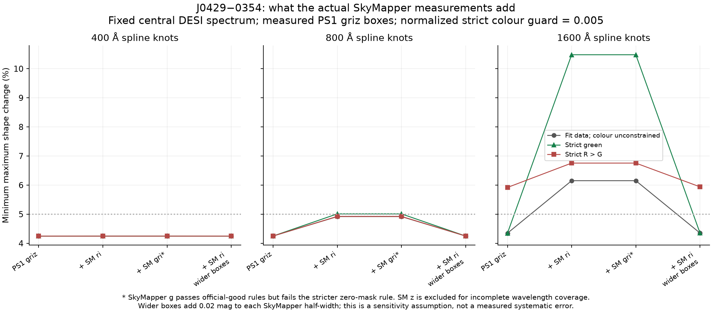
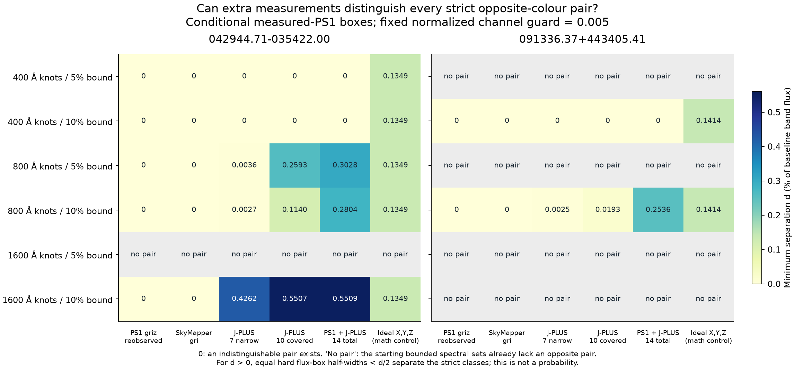
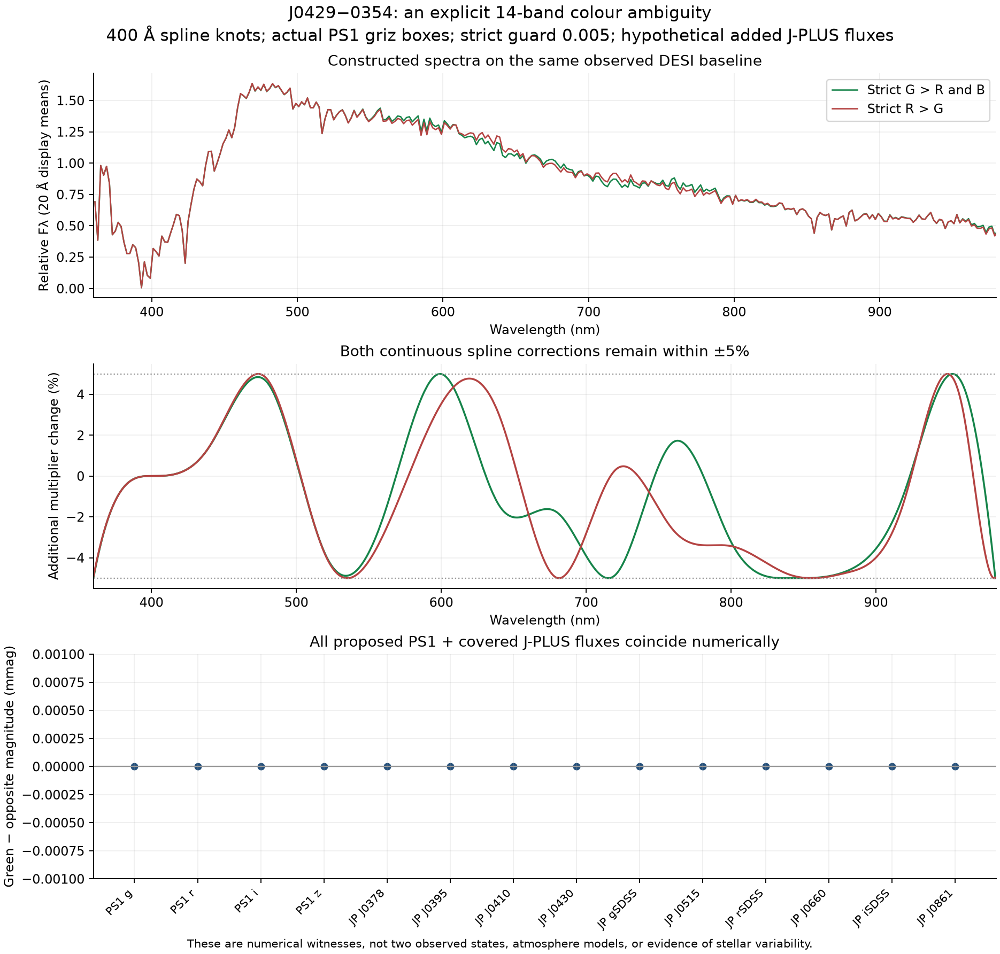
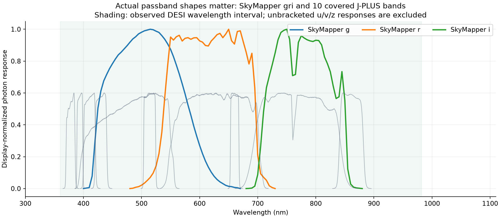

# 追加測光で、白色矮星の色をどこまで確定できるか

**2026年10月20日 UTC。探索的・未査読の解析。** [English](README.md) · [事前に固定した実験条件](DESIGN.md) · [実際の追加測光の解析条件](MEASURED_DESIGN.md)

実際に取得した SkyMapper / J-PLUS の測光による検証と、今後の追加フィルターで色を識別できるかという実験を行った。前者は新たに得た観測値、後者は仮想的な将来観測の設計である。

主な結果は、**較正の波長依存性を十分に自由にすると、測光バンドを増やしても J0429−0354 の緑・赤のチャンネル順序が決まらない場合が残る**ことである。400 Å 間隔のスプライン・最大5%変形という条件では、PS1とJ-PLUSを合わせた14バンドの予測が数値精度内で一致しながら、緑と赤の順序が逆になる二つの数値スペクトルを構成できた。

これは条件を明示した識別可能性の結果であり、その二つのスペクトルが実在する恒星大気だという証明ではない。今回の焦点は、望ましい色が出るように較正を固定することではなく、観測で許される色の範囲を定量化することである。

## 1. 新たに取得した観測値を使った検証

[追加測光の取得・品質報告](../independent_photometry/README.md)では、固定した25候補を全件照会した。SkyMapper 6バンドと J-PLUS 12バンドの **450枠**を残し、位置、固有運動、品質、個別露出まで確認して **14天体・52測定**を厳格品質で採用した。観測スペクトルが正式なフィルター応答全体を覆うことも要求すると、制約に利用できるのは **同じ14天体・46測定**となる。

予測は、以前固定した DESI + PS1 gri 再較正スペクトルを各調査の実際の応答関数で積分した。SkyMapper g と PS1 g のように同じ文字のフィルターを同一とは扱わない。負の有効画素を消さず、スペクトルの外挿や新たな消光補正もしない。

SkyMapper と J-PLUS は別の撮像で得られた光子観測だが、零点較正の完全な独立性はない。Gaia による較正や、J-PLUS の白色矮星 locus / PS1 r アンカーを共有する。このため、測定を単純に独立な確率として掛け合わせて発見確率を計算していない。J-PLUS の零点 offset は適用済みなので再加算せず、推奨された零点誤差のみ測光誤差へ追加した。

### J0429−0354 に何が加わったか

Gaia DR3 `3204436719718449280` は SkyMapper `24884480` と一致し、観測 epoch に移した位置差は約0.087″。主解析には SkyMapper **r = 18.8450 ± 0.0181、i = 18.7919 ± 0.0197 AB等級**を加えた。g は公式 good 条件では使えるが、平均に含まれた露出にマスク画素が4個あるため、厳格条件の外に置いた補助ケースにした。z は品質を通っても、正式な応答全体をスペクトルが覆わず制約に使わない。この天体の J-PLUS 測定を取得したわけではない。

各条件で、観測誤差箱を同時に満たすために必要な**最大の連続的な乗算変形の最小値**を計算した。「厳格な緑」は、固定した線形RGBの尺度で G−R、G−B がともに0.005以上となる条件である。この0.005は数値的な判別余白であり、人の知覚限界ではない。

| J0429・800 Å スプライン | 測光のみを合わせる最小変形 | 厳格な緑の最小変形 | 厳格に R > G の最小変形 |
|---|---:|---:|---:|
| 既存の PS1 griz | 4.2492% | 4.2492% | 4.2492% |
| PS1 + 厳格な SkyMapper r/i | 4.9175% | 5.0103% | 4.9236% |
| 上と同じ測定で、追加測光の誤差箱半幅に0.02 magを加える | 4.2492% | 4.2492% | 4.2492% |

主条件では厳格な緑の必要変形が5%をわずかに超える。しかし追加の誤差幅を変えるとこの違いはなくなり、スプライン間隔によっても結果が変わる。**「5%で緑が通らなかったから赤と確定」とは言えない。** 5%も追加0.02 magも感度解析の仮定であって、実測された較正誤差の分位点ではない。補助の g を加えても、この境界付近の主な最小値はほぼ同じだった。



### 全候補のずれも残した

[measured_predictions.csv](measured_predictions.csv)は、450枠の予測、原測定、品質不採用、波長範囲不足を残す。全25対象の図を実際に開き、[一件ごとの目視台帳](individual_photometry_review.csv)を作成した。白抜きの不採用点を残してあるため、大きな残差を見えなくする選別はしていない。

J1031 の SkyMapper i には、fit前の予測−観測で約+0.163 magの差がある。J0716 は800 Åのモデルで全採用測光を合わせる最小変形が67.09%、J0006 は95%という最適化上限内でも解がない。これらは宣言した中心スペクトル・測定箱・滑らかな変形族の不整合であり、実際の装置誤差が67%や95%だという測定ではない。J0006 は既に J-PLUS の金属外れ値として公刊されており、青側の不確かさや aperture 依存性も確認する必要がある。

全体では **165条件・660個の色分岐最適化**を実行し、595個の解を直接再積分、65個の上限制約内で解がない場合を保持した。追加測定を fit に使った後、その同じバンドでよく合うことを独立な検証とは呼ばない。fit前の予測を別に保存する理由である。

## 2. 追加フィルターが「許される色の集合」を区別できるか

固定した中心スペクトルを f₀、連続的な三次スプラインを s とし、

\[
f(\lambda)=f_0(\lambda)[1+s(\lambda)],\qquad
\max_\lambda |s(\lambda)|\leq\epsilon
\]

を考えた。間隔は400、800、1600 Å、最大変形は5%、10%。乗数は正だが、元の雑音に由来する負の画素は残る。各スペクトルは同じ実測 PS1 griz の誤差箱を満たし、積分XYZが正であることを要求した。大気の自己無撞着な物理モデルはこの集合に課していない。

緑側と、厳格な R > G または B > G の側を、それぞれ独立に動かす。追加バンド j の光子流束を Lⱼ とし、

\[
d=\min_{f_G,f_O}\max_j
\frac{|L_j(f_G)-L_j(f_O)|}{L_j(f_0)}
\]

を最小化した。以前保存した二つの例だけでなく、許された両集合の組み合わせを調べる。二つの反対側分岐の和集合を明示的に扱い、厳格な緑と反対側の間の細い領域は未判定とする。

- **数値的に d = 0：** 同じ追加流束を与える逆順序の組が少なくとも一つ残る。将来得られるどんな測定値でも曖昧という意味ではない。
- **正の双対下界がある：** 共通の流束誤差箱の半幅がその下界の半分より小さければ、その箱は両方の厳格集合と交われない。十分条件には実行可能例の上界でなく、下界を使う。
- **逆順序の組がない：** 追加観測の前から、設定した形状制約が両方を許していない。追加フィルターの成果には数えない。

### 主な結果

d の単位は各バンドの固定した中心流束に対する比。0は検算した数値精度内での一致である。

| 天体・間隔・変形上限 | PS1 griz再測定 | SkyMapper gri | J-PLUS 狭帯域7本 | J-PLUS 全域を覆う10本 | PS1 + J-PLUS 14本 |
|---|---:|---:|---:|---:|---:|
| J0429・400 Å・5% | 0 | 0 | 0 | 0 | 0 |
| J0429・800 Å・5% | 0 | 0 | 0.0000360 | 0.0025928 | 0.0030284 |
| J0429・800 Å・10% | 0 | 0 | 0.0000265 | 0.0011399 | 0.0028042 |
| J0913・400 Å・10% | 0 | 0 | 0 | 0 | 0 |
| J0913・800 Å・10% | 0 | 0 | 0.0000245 | 0.0001929 | 0.0025357 |

例えば J0429・800 Å・5%・J-PLUS 10本では、双対下界から得る誤差箱半幅は中心流束の **0.1296%未満**という厳しい十分条件になる。一方、400 Åでは14本でも一致する組が残った。フィルター数だけでなく、**どの波長スケールの較正変形を実際の装置が許すのか**が重要になる。これはこの天体・この形状族・この誤差箱に対する条件付きの結果であり、普遍的な観測要求ではない。





図の二本は一つの観測スペクトルから構成した反例であり、実際に二つの状態が観測されたわけではない。一般的なメタメリズムやフィルター選択は既存の概念である。この対象について条件・証拠・数値的な上下界を公開する部分が今回の成果であり、一般定理の新発見とはしていない。

## 3. 応答関数と波長範囲

[SVO原応答の台帳](profile_manifest.json)に18本のURL、取得時刻、SHAを保存した。J-PLUS はフィルター単体の透過率ではなく、CCD・光学系・大気を含む系全体の応答を用いた。J0378、J0395、J0410、J0430、J0515、J0660、J0861 と g/r/i の10本が全域を積分可能である。SkyMapper u/v/z と J-PLUS uJAVA/zSDSS は、このスペクトルの全域被覆条件を満たさない。

J-PLUS 表は端で小さな非零応答を持つ。全ての表値を残し、外側1 Åにゼロを付けて閉じるという数値上の約束を記録し、10 Åで閉じる場合も8条件再計算した。dの最大変化は6.61×10⁻⁸未満で、実行可能性は変わらなかった。この試験は表端の数値処理の感度であり、実際の透過率誤差の推定ではない。



## 4. 検証範囲

将来観測の設計は **276条件＋端点感度8条件＝568分岐問題**。極値制約の追加や数値アルゴリズムの再試行も含む内部 solver 呼び出しは1455回である。169組・338本の実行可能スペクトルを直接再積分し、399分岐の実行不能を再計算した。

スプラインは描画用の離散点だけでなく、導関数の根で連続最大値を確認した。係数を制限した小さい集合から解を作る高速化では、そこで解がないことを元の大きい集合の実行不能と取り違えない。下界は元の有限制約問題の双対から保持する。主張は浮動小数点検算の精度内であり、形式的な区間演算証明ではない。

二実験で計2121件の集合包含チェックも通った。連続上限制約の超過は最大2×10⁻⁹未満。さらに[独立実装のレビュー](independent_review/README.md)で、6条件を元の制約生成器を使わず再構成して確認した。

```bash
python research/measurement_design/verify_outputs.py --write-report
python research/measurement_design/verify_measured.py --write-report
python research/measurement_design/plot_results.py
python scripts/verify_research_oct20.py
```

[将来観測設計の検算](verification.json)、[実測追加制約の検算](measured_verification.json)、[実際に表示した図の記録](visual_review.json)を公開する。図を生成しただけでは目視済みと数えていない。

## 5. 次に決着を付けるための実験

[実際の反復観測](../repeat_shape_validation/README.md)では形状差を測れたが、完全なDESIの3組と選んだSDSSの1組だけで、装置の較正誤差分布を推定することはできない。J0429/J0913 は取得済み露出が各1件で、この二対象について反復差が測れたわけでもない。

次に必要なのは、同じ装置・明るさ・観測条件に対応する標準星と反復分光から、波長依存の較正と共分散を候補の判定前に固定すること。その条件で今回の色集合と新しい観測を比較し、元素比や二成分大気の説明が、fitに使わない測光・線の輪郭まで予測できるかを試すことである。

原データの帰属は DESI、PS1、SkyMapper、J-PLUS、Gaia、SVO と各原著者にある。[追加測光の出典・謝辞](../independent_photometry/README.md#出典利用条件謝辞)と [既存の出典](../literature/DATA_ACKNOWLEDGMENTS.md)を引き継ぐ。プロジェクトの発案・維持は Shota Moriwaki、解析と文章作成には ChatGPT をツールとして使用した。
