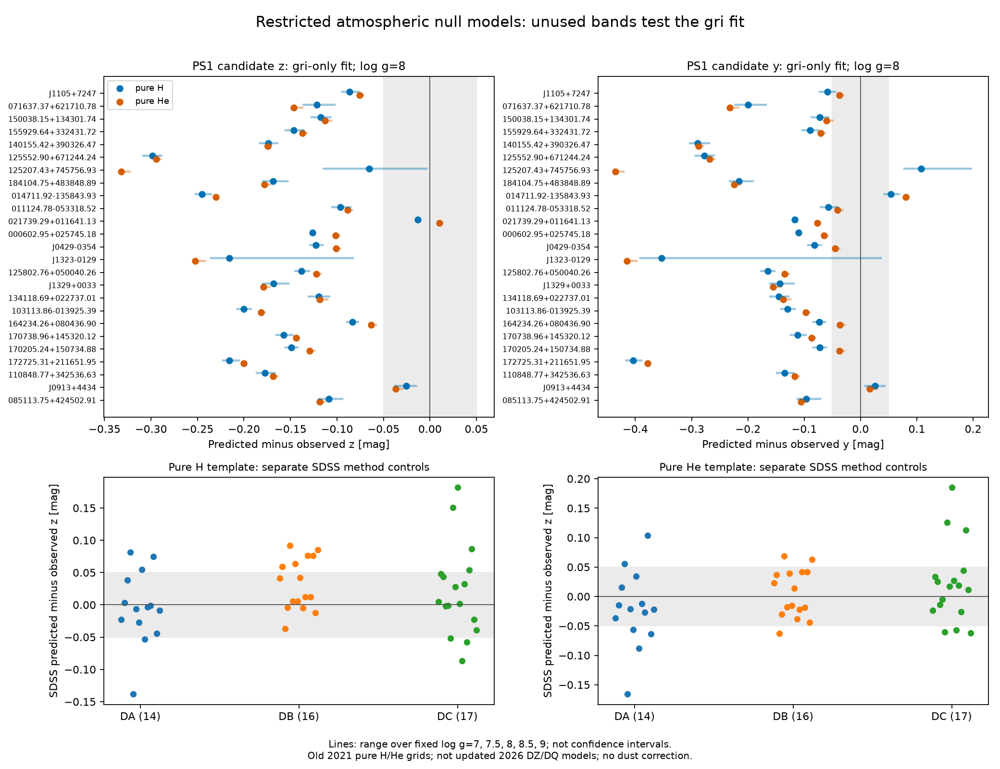
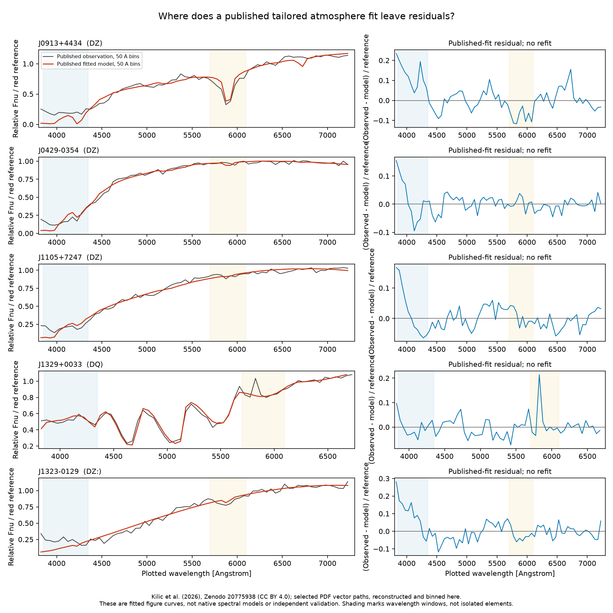

# 公開大気モデルを使った追加検証

この追加解析では、固定した初期27候補について、**数値モデル表からの未使用バンド予測**と、**著者が公開した組成別モデル図の局所残差診断**を実行した。元の候補選択や既存の色計算は変更していない。

主要な結果は、J0913+4434が、金属を含まない古い対照モデルでもgriからz・yを約0.04等級以内で予測できることである。一方、同じ天体の公刊済み金属大気モデル図には、青側と約5900 Å付近で符号の異なる残差が残る。**この検査で広帯域予測に合うことは、大気組成が正しいことを保証しない。** 他候補の広帯域予測の不一致を、新しい物理の発見と解釈することもできない。

## 取得したものと、実行できる比較の範囲

| 一次資料 | 実際に入手できた形式 | 今回の利用 |
|---|---|---|
| [Montréal 合成色・進化モデル](https://www.astro.umontreal.ca/~bergeron/CoolingModels/) | 純H・純He大気の合成絶対等級表 `Table_DA`, `Table_DB` | griだけを合わせ、使用しないz・yを数値予測 |
| [Kilic et al. 2026](https://arxiv.org/html/2606.25377v2) / [著者のZenodo公開図](https://zenodo.org/records/20775938) | 物理パラメータ表と、観測・最適モデル曲線を含むPDF | 全25対象をGaia IDでページ照合し、描画ベクトルの50 Å残差を計算 |
| [Swan et al. 2026](https://arxiv.org/html/2609.04314v1) / [Warwick公開データ](https://cygnus.astro.warwick.ac.uk/phsdaj/WhiteDwarfs/) | 観測スペクトル、測光、パラメータ事後サンプル、図 | 前回保存した正確なID対応のPS1測光を使用。事後パラメータ表をスペクトル配列と扱わない |
| [Hollands et al. 2026](https://arxiv.org/html/2610.18966v1) | 論文、個別大気モデルは合理的な要請に応じて提供と記載 | 公開取得を確認できたDZ/DQのnativeモデル配列としては使用していない |

確認した著者配布先では、Kilicの対象別DZ/DQについて再合成・再フィット用のnative波長・fluxモデル配列を取得できなかった。以下のPDF診断は、その欠落を埋める精密モデル実験ではない。外部への問い合わせは行っていない。

### モデルの版は主要な制限

Montréalの取得ファイルは両方ともヘッダーが **2021-01-13**、説明ページの更新日は2020-08-18である。これらはKilic 2026 §II.1が報告する **H3+分配関数を8で割る修正**より前の公開表である。純H/純Heという組成の制限に加え、この版差がある。2026年の更新済みDZ・DQ・混合H/Heモデルの成否を、この対照表から判定してはならない。特に超低温のJ1323−0129で重要な制限である。[原論文 §II.1](https://arxiv.org/html/2606.25377v2#S2.SS1)

## 実験1：griだけで合わせてz・yを予測

[実行コード](photometric_null_models.py)は、各組成・各固定重力で、温度と加算等級定数だけを自由にする。定数は距離・半径による全体の明るさを吸収するためのもので、距離や半径は推定しない。モデルの各区間で等級をlog温度に線形補間し、**全区間の最小値を解析的に比較**する。冷たい純Hの色が単調でない場合も、局所解だけを採用しない。

主結果は `log g = 8` 固定。`7, 7.5, 8, 8.5, 9` の各値も計算し、重力への感度を保存した。モデル列はPS1とSDSSを明示的に分ける。griの重みは `max(報告誤差, 0.02 mag)` による対角重みで、完全な共分散でも有意性計算でもない。z・yは温度、重力、組成の選択に使わず、両組成の結果を残す。消光は補正しておらず、PS1の共有された較正・観測時期も独立性の制約になる。

27対象のうち25対象でPS1測光を使用できた。2対象は欠測理由を記録して残した。別途、既存のSDSS対照54天体から、残差を見る前に `clean=1`、grizの有限値・正の報告誤差・各誤差0.1等級未満を要求し、47対象（DA14、DB16、DC17）を使用した。25候補と47対照、2組成、5重力で **720フィット**となる。

### 代表5対象の未使用バンド残差

数値は `予測 − 観測`、単位は等級。負の値は予測モデルの方がそのバンドで明るい。表の温度はこの制限されたテンプレートの値であり、天体の物理温度の測定ではない。丸め前の全結果は [主結果CSV](photometric_predictions_logg8.csv) と [全重力CSV](photometric_predictions.csv) にある。

| 天体 | 対照組成 | テンプレート温度 K | gri最大絶対残差 | z残差 | y残差 |
|---|---|---:|---:|---:|---:|
| J0913+4434 | 純H | 4973 | 0.029 | −0.026 | +0.026 |
| J0913+4434 | 純He | 4645 | 0.027 | −0.037 | +0.017 |
| J0429−0354 | 純H | 5967 | 0.064 | −0.123 | −0.082 |
| J0429−0354 | 純He | 5794 | 0.058 | −0.101 | −0.045 |
| J1105+7247 | 純H | 5446 | 0.041 | −0.087 | −0.059 |
| J1105+7247 | 純He | 5202 | 0.040 | −0.075 | −0.038 |
| J1329+0033 | 純H | 4731 | 0.061 | −0.168 | −0.144 |
| J1329+0033 | 純He | 4415 | 0.076 | −0.179 | −0.155 |
| J1323−0129 | 純H | 4137 | 0.087 | −0.216 | −0.353 |
| J1323−0129 | 純He | 3905 | 0.112 | −0.252 | −0.415 |

主設定では、両組成とも25候補中23対象で `|z残差| > 0.05 mag` となる。これは旧版・不適切な組成も含む制限された対照モデルの診断であり、最新モデルの失敗率や発見率ではない。gri自体を0.05等級以内で再現できる対象も、純Hで14、純Heで11に限られる。主設定で温度グリッド端に到達する候補はない。[計算要約](photometric_summary.json)

SDSS対照は別のフィルター・選択標本なので、候補の23/25と比較した偽陽性率は求めない。主表は報告されたSDSSのnear-AB値を使う。[SDSS DR17の較正説明](https://www.sdss4.org/dr17/algorithms/fluxcal/)にある不確かな `z_AB = z_SDSS + 0.02` の場合も、別列 `heldout_z_if_sdss_plus0p02_AB_mag` に保存した。この場合z残差は一律0.02等級だけ負側へ動き、griフィットは変わらない。残差を小さくするための零点推定は行わない。DR17のhypercalibration自体がPS1を使用するため、測光較正の独立性も主張しない。



図の線は重力設定による最小〜最大で、信頼区間ではない。入力81対象を欠測・品質除外も含めて残した [入力台帳](photometric_input_coverage.csv) から各行を追跡できる。

## 実験2：公刊された組成別フィットのどこに残差があるか

[抽出コード](extract_published_curves.py)で `allfitsDQ.pdf` と `allfitsDZ.pdf` の原本SHA256・ZenodoのMD5を照合した。パラメータ表の順序から候補ページを選び、全25ページでGaia IDを別途OCR確認した。OCRで挿入された空白だけを除去して一致を要求し、数字の置換は行わない。各ページの軸目盛りと、黒い観測・赤いモデルのベクトル座標を [マニフェスト](sources/published_curve_manifest.json) と25個の小さなNPZに保持した。元PDF全文はこのフォルダーに転載していない。

これは著者が既に合わせたモデルと、そのフィットに使った観測の比較である。元の観測表示は5点、約4 Åで平滑化されている。下段の縦軸は **relative Fν**、横軸範囲はDQで約3800–6750 Å、DZで約3800–7300 Åである。完全可視域のFλスペクトルではないため、図由来のCIE色や色差を再計算しない。[Kilic et al. 2026、図3の説明](https://arxiv.org/html/2606.25377v2)

[診断コード](published_curve_diagnostics.py)は、描画座標から1 Å間隔の曲線を再構成し、完全に範囲を満たす50 Å区間の中央値を取る。モデルの6200–6500 Åにおける基準値で両方を同じように割り、スケールを再フィットせずに差を比較する。以下は3850–4350 Åと5700–6100 Åにある区間残差の平均で、**分母はその波長の局所fluxではなく赤側基準値**である。

| 天体 | 青側3850–4350 Å | 5700–6100 Å | 全区間3850–6500 Åの絶対残差中央値 |
|---|---:|---:|---:|
| J0913+4434 | +11.63% | −8.25% | 3.92% |
| J0429−0354 | +0.57% | +0.47% | 2.16% |
| J1105+7247 | +1.13% | +0.36% | 3.07% |
| J1329+0033 | −0.67% | +1.87% | 2.16% |
| J1323−0129 | +8.63% | −2.74% | 4.33% |

描画座標の量子化は約0.24 PDF pointで、波長にすると約1.45–1.71 Åである。軸目盛りの丸めと曲線座標をずらす9通りの感度解析も各対象で実行した。ただし、これは観測誤差、sky subtraction、mask、分解能行列、モデル誤差を表さない。図からχ²、有意性、元素量、等価幅を推定していない。波長窓のCa・Mg・Na・C2という名前は、調べる特徴の位置を示し、単一元素だけの寄与を意味しない。

全27対象の状況は [対象ごとの残差表](published_curve_residuals.csv)、各区間と欠測数は [50 Å全区間表](published_curve_50A_bins.csv)、入出力検証は [実行要約](published_curve_summary.json) に保存した。磁気分類 `DQH` の1対象については、掲載モデルが磁気大気モデルであると解釈しないためのフラグもある。

[25対象すべての一覧図](published_curve_all25.png)でも曲線を点検できる。全区間の絶対残差中央値が最大の対象は、既に磁気分類DQHを持つJ1255+6712で、赤側基準の9.57%。既知の磁気分類とモデルの制限があるので、この順位を未知の元素や新しい大気物理の候補順位と同一視しない。



J1329+0033の主要なC2吸収構造は、既存のDQモデルで既におおむね説明される。J0913+4434では、広帯域の旧H/He対照予測に合うことと、分光曲線の局所残差が残ることが同時に成立する。J0429・J1105については、青側の正負が平均で相殺するので、一律の青側超過を主張できない。これらは図の数値化から得た検証対象の整理であり、新しい星・元素・物理過程の発見ではない。

## 次の検証可能な仮説と、必要な証拠

1. **J0913の組成情報は広帯域より局所形状に残る。** 青側と約5900 Åの一方をモデル選択に使わず、別の波長域で決めた最新DZモデルが未使用域を予測するかを調べる。Caに対して他金属を固定CI比にするモデルと、特定の比を解放するモデルを比較する価値がある。ただし、元論文の固定CI比は既知の仮定であり、その制限を再発見しただけでは新規性にならない。DESIのnative flux・ivar・mask・分解能、別夜の同じ残差、空間混入とsky残差の除外が必要である。
2. **DQの広帯域の失敗は、既知のC2帯による形状と整合するか。** J1329のように既存DQモデルが帯域を説明する対象を基準に、同じ温度・重力・較正条件で炭素を含む最新モデルの未使用測光を比較する。観測曲線から任意に帯域を削って「炭素なし」とする操作は、大気の自己無撞着な反実仮想にはならない。
3. **超低温天体の予測差は、モデル版・組成・重力のどれに支配されるか。** J1323では、H3+修正、混合H/He、金属、圧力下のCIAを同じ条件で切り分ける必要がある。今回の旧純H/He表だけで連星や追加放射成分を結論しない。更新済みモデル配列と、測光較正・混入を確認した近赤外観測による未使用バンド検査が必要である。

これらのモデル比較には、同じPS1測光を共有する較正結果や、同じDESI露出を別アーカイブから取得した記録を「独立な確認」と数えないことが前提になる。人口比率を論じる場合は、候補選択前から定義した同じサーベイ・品質・温度範囲の対照標本を別途設計する。

## 再現

以下はコミット対象の入力だけを使い、追加ネットワーク・大きな原PDF・観測キャッシュを必要としない。`requirements-core.txt` の依存だけで実行でき、カレントディレクトリに依存しない。出力には計算コードと入力のSHA256を記録する。

```bash
python /path/to/wish-you-were-green/research/model_validation/photometric_null_models.py
python /path/to/wish-you-were-green/research/model_validation/published_curve_diagnostics.py
```

PDFから抽出し直す場合だけ、追加のPyMuPDFと`tesseract`、原PDF用キャッシュが必要になる。取得元URLと期待SHA256はマニフェストに固定してある。

```bash
python research/model_validation/extract_published_curves.py \
  --pdf-cache /tmp/wd-published-fit-pdfs --download
python research/model_validation/published_curve_diagnostics.py
```

原表ハッシュ、明示的なフィルター列、候補・対照の全入力範囲、合成テンプレートの回収、全25ページのID、描画軸、曲線NPZハッシュ、基準区間の完全性を実行時に確認する。元表の等級は小数3桁の精度であり、計算結果の追加桁は再現用である。

## 出典・利用条件・謝辞

Montréalの合成等級表について、配布サイトの指定に従い、同サイトと [Holberg & Bergeron 2006](https://www.astro.umontreal.ca/~bergeron/CoolingModels/Synthetic_Calibration.pdf) を明記する。使用する温度域に対応するモデルは、同サイトに記載された [Blouin et al. 2018](https://www.astro.umontreal.ca/~bergeron/CoolingModels/Blouin2018.pdf)、[Tremblay et al. 2011](https://www.astro.umontreal.ca/~bergeron/CoolingModels/DA_models.pdf)、[Bergeron et al. 2011](https://www.astro.umontreal.ca/~bergeron/CoolingModels/DB_models.pdf)、[Bédard et al. 2020](https://www.astro.umontreal.ca/~bergeron/CoolingModels/Bedard2020.pdf) に基づく。配布原文・数値・版の日付は保持し、元表に独自のライセンスを付け直していない。

公開図の配布はKilic・Bergeronによる [Zenodo 20775938](https://zenodo.org/records/20775938)、ライセンスは **CC BY 4.0**。本解析では一部ページの描画ベクトルを抜き出し、軸変換・粗い区間化・残差計算という変更を加えた。元のモデル作成者、観測データ作成者、図の公開先に帰属する成果として扱う。原本PDFのハッシュ、ページ番号、元のパラメータ行、加工後NPZのハッシュを保管する。

PS1/Swan、SDSS/DESIの観測データの出典・利用条件は、既存の [文献・カタログ監査](../literature/README.md) とリポジトリのデータ謝辞を引き継ぐ。
