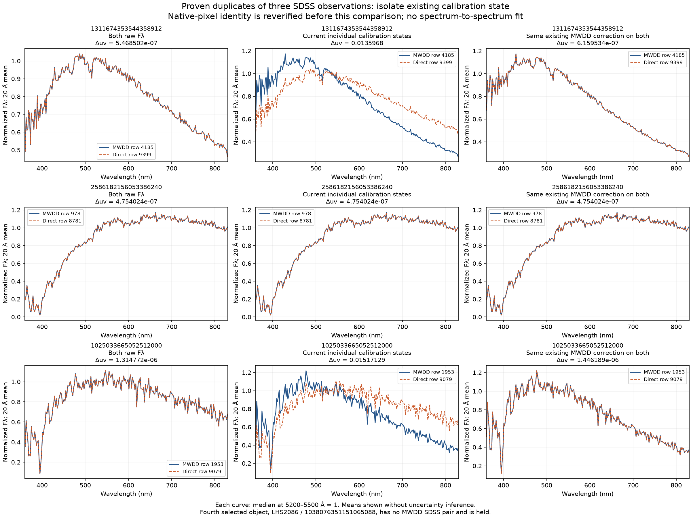

# 同じ SDSS 原観測で、較正の扱いだけが違う場合の監査

実見で連続光の不一致が気になった 4 天体のうち、3 天体には **同じ SDSS 原観測の MWDD 表現と直接 FITS 表現**があった。そのうち 2 天体では、現在の図に見える両表現の差のほぼ全部を、**既存の較正を片方だけに適用した状態**で説明できる。元のスペクトルが別の時期に変わったという比較ではない。[数値の全記録](results.json)、[比較表](comparison_summary.csv)、[較正の分岐表](photometric_decisions.csv) に、元の行番号と判断を保存した。

この監査で現在の凍結済みの色、順位、適格判定、126 枚の実見図を変更していない。将来、同じ観測の重複表現には共通の較正を持たせる必要があることを、具体的な原データで検証した追加結果である。

## 何を同じ観測と認めたか

既存の [単位証拠台帳](../../precision/flux_convention_evidence.json) を参照するだけでなく、3 組の原 bytes の SHA256 を再確認し、[元の厳しい画素照合](../../precision/flux_convention_audit.py) を再実行した。3 組とも (F_\lambda) の仮説だけが通過し、(F_\nu) の仮説は通過しない。

照合は 3,600–8,300 Å の元の標本を使う。波長の対応は 0.02 Å 以内、対応率・有限値率はそれぞれ 99% 以上、比較に使える標本は 1,000 個以上、波長幅は 3,500 Å 以上を要求する。単一の定数スケールを除いた相対残差と、参照流束の中央値を基準とする絶対残差の双方が (10^{-4}) 未満であることも要求する。波長の傾きが似ているだけでは同一観測にしない。補間・ビン化・傾斜の合わせ込みはこの照合に使わない。

| Gaia source ID | MWDD / direct の元行 | plate–MJD–fiber | 照合標本数 | 原画素の最大相対残差 |
|---|---:|---|---:|---:|
| 1311674353544358912 | 4185 / 9399 | 5201–55832–0412 | 3,620 | (4.6292\times10^{-6}) |
| 2586182156053386240 | 978 / 8781 | 4661–55614–0318 | 3,469 | (4.5801\times10^{-6}) |
| 1025033665052512000 | 1953 / 9079 | 7445–56720–0047 | 3,569 | (4.8627\times10^{-6}) |

3 組とも原波長の対応率は 100%、対応した波長の差の最大値は約 0.00561 Å。上の相対残差で分母を安定させるために外した小さい参照値や負の値も、別の絶対残差条件に含めた。照合の全閾値、両単位仮説の残差、原ヘッダー、原 URL・SHA は `results.json` にある。

4 天体目の **1038076351151065088 / LHS2086** には、比較できる MWDD SDSS 表現がない。MWDD row 3786 は別の Bergeron の入力で、現在も単位未確認である。XP 3787 と直接 SDSS 9122 の不一致を、この重複表現の監査で説明したとは扱わない。

## 比較した 3 条件

同定できた各組について、次だけを比較した。

1. 両方とも元の (F_\lambda) のまま。
2. 凍結された現在の処理状態を各表現に再現。
3. MWDD 側ですでに受理されている同じ補正を両表現に適用。MWDD に受理された補正がなければ、両方とも未較正。

既存の補正は

\[
F'_\lambda(\lambda)=F_\lambda(\lambda)
10^{-0.4[a+b(\lambda-6200\,\mathrm{\AA})/(1000\,\mathrm{\AA})]}
\]

で、(a,b) は保存済みの値をそのまま使う。逆分散がある入力では乗算因子の二乗で割る。**スペクトル同士を一致させる新しいパラメーターは求めていない。**

色は既存の有限値・逆分散・狭い空輝線マスクを通した元の格子で計算する。表示だけは、各曲線を 5,200–5,500 Å の中央値で規格化し、20 Å の算術平均にする。今回の 3 組では色積分に残る可視域標本数も各 3,580 個で一致した。波長・流束の書き出しの丸めが残るため、二つの計算結果を数値上まったく同一にする操作はしていない。



上の 9 パネルは生成後に実際に開いて確認した。左列・右列では各組の曲線が重なり、中央列の上段・下段だけに青側と赤側の大きな分離が見える。[実見の記録](visual_review.json) は確認した PNG の SHA に結びつく。これは新たな 9 天体や独立な 9 観測の確認数ではない。平均線の図に新しい誤差の推定や線検出の有意性は付けていない。

### 色の差の解消量

ここで $\Delta uv=\sqrt{(u_1-u_2)^2+(v_1-v_2)^2}$ は、同じ観測の二つの表現の間の距離である。Planck 軌跡からの距離とは異なる。

| Gaia source ID | 両方未較正の $\Delta uv$ | 現在の個別状態 | 共通の既存補正 | 現在の表現間の差の縮小 |
|---|---:|---:|---:|---:|
| 1311674353544358912 | (5.4685\times10^{-7}) | 0.01359679846 | (6.1595\times10^{-7}) | 99.99547% |
| 2586182156053386240 | (4.7540\times10^{-7}) | (4.7540\times10^{-7}) | (4.7540\times10^{-7}) | もともと両方未較正 |
| 1025033665052512000 | (1.3148\times10^{-6}) | 0.01517128821 | (1.4462\times10^{-6}) | 99.99047% |

規格化した対応画素の相対差の絶対値の 95 パーセンタイルも、131167…では現在の **38.2194% → 0.000194%**、102503…では **42.9481% → 0.000353%** に変わる。分母は参照流束の絶対値中央値の 0.1 倍を超える値だけに限定した。この割合は「物理的な変動の何割を消したか」や「装置の較正誤差の何割を説明したか」という推定ではなく、指定した同一観測の表現間の差の記述である。

MWDD 側の受理された傾斜による、4,200 Å と 7,000 Å の補正因子の比はそれぞれ **1.67548** と **1.79129**。図の青と赤の分離は、すでに使われているこの大きさの補正と整合する。

## なぜ片方だけに較正がかかったか

原入力に凍結された測光値と誤差を、変更していない `recalibrate_gri` と既存の逐次判定へ戻して再演した。この再演は分岐の説明用で、棄却された fit を図に使ったり、異なる装置の曲線へ合わせたりしていない。現在の係数と受理・棄却状態が再現することも検証した。

| 元行 | 系 | 傾斜 (b), mag / 1,000 Å | 最大バンド残差, mag | 原条件での判断 |
|---:|---|---:|---:|---|
| 4185 | SDSS | 0.200125 | 0.133664 | 受理 |
| 9399 | SDSS | 0.202830 | 0.158159 | 残差 0.15 mag 以上で棄却。PS1 の入力なし |
| 1953 | SDSS | 0.277798 | 0.100132 | 傾斜の絶対値 0.25 以上で棄却 |
| 1953 | PS1 | 0.226040 | 0.059489 | 代替の PS1 fit を受理 |
| 9079 | SDSS | 0.290212 | 0.084130 | 傾斜の絶対値 0.25 以上で棄却。PS1 の入力なし |
| 978 | SDSS / PS1 | 0.407660 / 0.397139 | 0.124681 / 0.097464 | 両方とも傾斜で棄却 |
| 8781 | SDSS | 0.403772 | 0.126558 | 傾斜で棄却。PS1 の入力なし |

4185 と 9399 の傾斜自体は近い。しかし、測光値とその重みが違い、最大残差が受理閾値の両側になった。1953 と 9079 では SDSS の fit が両方棄却されるが、MWDD の入力だけが PS1 に進める。したがって、同じ原スペクトルをファイルごとに個別処理すると、閾値での分岐と代替測光の有無が大きな表現差になる。

### 4185 / 9399 の測光キーをどこまで確認できたか

直接取得した SDSS 9399 の測光は、同じ原 FITS の HDU2 にある **BESTOBJID `1237662498937438470`** と PSFFLUX / PSFFLUX_IVAR から作られている。既存 `sdss/manifest_with_photometry.json.gz` の値とも一致する。この段階で新しい最近傍の測光検索はしていない。

| バンド | MWDD の凍結値 ± 誤差 | 直接 FITS 流束からの値 ± 誤差 | 直接 − MWDD, mag |
|---|---:|---:|---:|
| g | 19.122 ± 0.011 | 19.146814 ± 0.016175 | +0.024814 |
| r | 19.110 ± 0.013 | 19.135161 ± 0.028965 | +0.025161 |
| i | 19.111 ± 0.019 | 19.125151 ± 0.024645 | +0.014151 |

直接側で流束から計算した等級と、同じ HDU2 の PSFMAG の差は g/r/i で約 (1.90,3.25,6.94\times10^{-5}) mag にすぎず、上の 0.014–0.025 mag の差をこの等級表現の違いだけで説明できない。一方、**MWDD の凍結入力には測光 objID と測光 epoch がない**。両方が同じ撮像検出か、異なる公開版か、別の対応先かはこの入力だけでは確定できない。最近傍の誤同定や実際の変光を原因と断定しない。

## 残る問題と次の実装上の改善

131167…は共通補正の SDSS と現在の XP / DESI の間に、なお $\Delta uv$ 約 **0.00884 / 0.01113** が残る。102503…も XP との間に約 **0.01098** が残る。258618…では重複 SDSS はもともと同じだが、XP / DESI との差は約 **0.03406 / 0.03401** ある。この監査は異なる装置間の残差を解消したものではなく、混入・観測条件・時間変化・絶対分光較正などの追確認を引き続き要する。[位置と観測 epoch の診断](../association_diagnostics/README.md) と併せて扱う。

この結果が支持する実装方針は、原 SHA・厳密な画素同定・plate/MJD/fiber で同じ観測をまず束ね、その単位で測光の出典を選んで較正状態を共有すること。その際も原表現、未較正の色、個別測光入力、受理・棄却理由は残す。異なる観測や単位未確認の記録を、この3例の都合のよい一致から自動的にまとめない。共通補正が物理的に正しいかは、元測光キー・測光 epoch と独立な観測情報を確認して評価する必要がある。

## 再現

```bash
.venv-research/bin/python research/outlier_followup/representation_calibration.py
```

3 つの MWDD 原 CSV の bytes を、このディレクトリの `raw_row_*.csv.gz` に可逆圧縮して同梱する。対応する直接 FITS は [association_diagnostics/](../association_diagnostics/) の既存の圧縮原本を再利用する。解凍後の SHA を凍結入力と照合するため、大きな survey cache や新しい外部取得なしでも、この3組の実験を再実行できる。`results.json` に入力コード・台帳・原本と図・数値表の SHA を記録した。

[verify_outputs.py](verify_outputs.py) の `verify(root)` は読み取り専用の CI 用検証である。同梱した 6 原本を直接解凍し、3 組 × 3 条件の色積分、原画素の厳密な同定、保存済み測光を使った 11 個の逐次判断を再計算する。原キャッシュ・ネットワーク・図の再生成は不要で、返り値は `summary` と `verified_file_sha256` を含む。`cwd=/tmp` からの実行でも PASS し、9 条件の記録値との差は最大 (1.74\times10^{-18}) だった。これは再計算の数値的一致であり、物理的な測定精度ではない。
