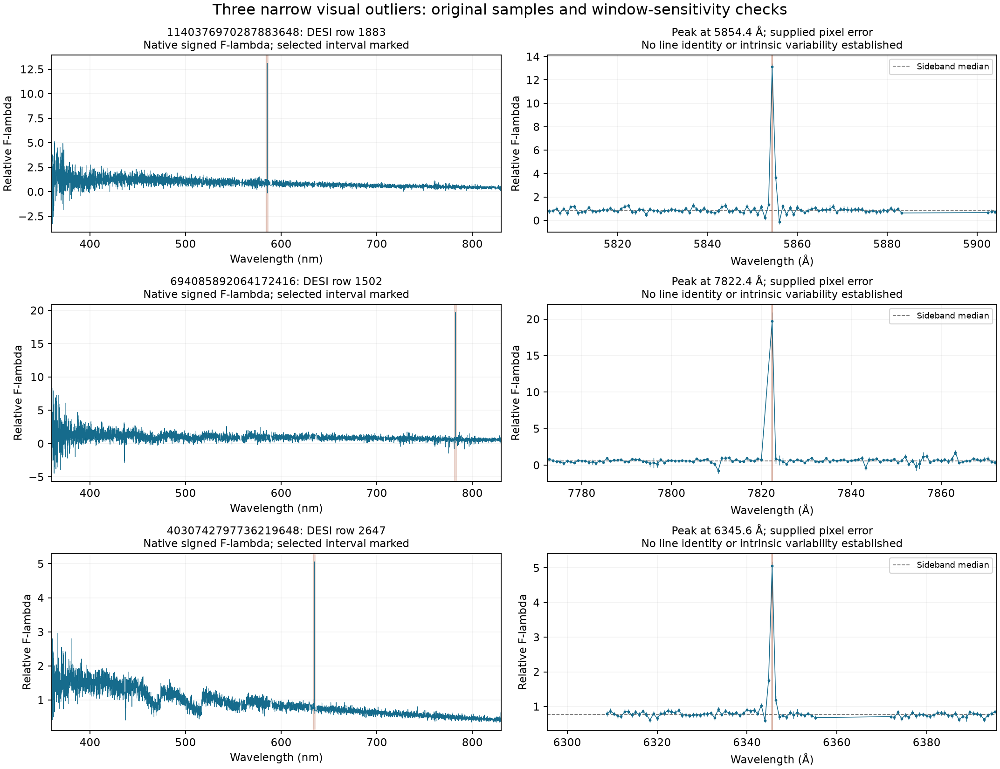

# 目立つ細いピーク3例を原画素まで戻って確認

2026-10-19 UTC。全範囲表示・拡大表示で実際に見つけた3つのピークについて、**原スペクトルの波長、符号付きフラックス、供給された画素誤差を直接確認**しました。



| Gaia DR3 source_id | DESI row | 原格子でのピーク位置 | 指定した削除試験の最大Δuv |
|---|---:|---:|---:|
| 1140376970287883648 | 1883 | **5854.4 Å** | 0.000806113 |
| 694085892064172416 | 1502 | **7822.4 Å** | 0.000000144458 |
| 4030742797736219648 | 2647 | **6345.6 Å** | 0.000282102 |

row1502と2647の初見での波長見積もりは粗く、対象ピークから外れていました。元配列の極大を照合して7822.4 Åと6345.6 Åへ訂正し、その**実際の特徴を含む窓**で感度を計算し直しました。目視記録にも訂正を追記しています。最初の概数を原画素測定と扱ったり、別の波長を調べた結果で特徴を確認済みとしたりしていません。

## 何を計算したか

現在の単位・較正・有限値・正IVAR・狭い空輝線マスクを固定して色を再計算し、現行台帳との一致を確認しました。表示用に平均した点でなく元の格子を使い、ピークから20–50 Å離れた両側のフラックス中央値を周辺の比較値としました。

「ピーク−周辺中央値」をピーク1画素の供給誤差で割った比は、順に39.28、15.68、35.83です。これは単なる記述統計です。ピークを見て選んだこと、周辺値の推定誤差、再標本化の共分散、空・検出器・較正の系統誤差を含まないため、39σ等の線検出の有意性と呼びません。

次に、(1)ピーク1画素のみ、(2)ピーク±4 Å、(3)ピーク±10 Åをそれぞれ一時的に外して再積分しました。欠けた窓の間を補間する明示的な感度試験であり、失われた真の恒星フラックスを測った結果ではありません。3種類の窓と全9試験を[結果JSON](native_peak_results.json)に保存しました。

7822.4 Åの突出は見た目には非常に大きくても、この色計算への影響は小さいことが分かりました。色一致関数の波長による重みがあるので、グラフの縦の高さだけで色度の影響順位を決められません。他の2例はより大きく色度を動かしますが、今回の窓試験だけから正しい除去幅や原因は決まりません。

## 判定と残る課題

**3例とも原スペクトルと現行の色を保持しました。** 新しい本番マスクは追加していません。線の同定、恒星の放射線、宇宙線、空差し引きの残差など、原因の確定には原露出・カメラ別MASK・分解能・検出器画像等が必要です。MWDD出力の `flag` をnative DESIのカメラMASKと同一視していません。

3つの原テキストを可逆gzipで同梱し、圧縮前後のSHA256、取得元URL、現在の較正状態を保存しています。[再生成コード](../spike_diagnostics.py)は作業環境の元キャッシュを使いますが、次の検証は同梱した証拠だけで完結します。

```bash
python scripts/verify_research_followup.py --group native
```
