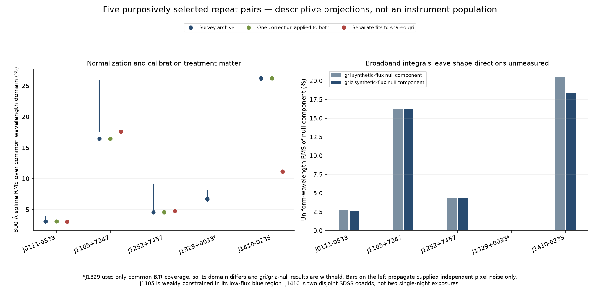

# Repeated observations: wavelength-dependent shape validation

This experiment measures differences between **four DESI repeat pairs and one pair of disjoint SDSS coadds**, using common native pixels, masks and normalization. It adds a wavelength-dependent check to the earlier colour comparisons. The strongest case is SDSS J141005.73−023500.2: its two archive coadds differ by **0.31269 mag in synthetic PS1 g−r**. Their 800 Å smooth multiplicative projection has **26.238% uniform-wavelength RMS**; separate corrections fitted to the same photometry reduce that RMS to **11.179%**, while leaving a **0.11960 mag normalized z difference**. These are descriptive differences for a selected object, with unresolved instrumental and astrophysical causes.

The SDSS inputs are **two multi-night coadd sets, spanning five nights and 18 distinct physical exposures**. Their nominal MJD labels do not identify two individual nights. The experiment supplies neither a calibration-error distribution nor a variability discovery, and it does not measure the calibration uncertainty of J0429−0354 or J0913+4434. All numerical results below come from [analysis_results.json](analysis_results.json), [the summary table](repeat_shape_summary.csv), [band differences](synthetic_band_differences.csv), and [original-source context](sdss_context.json).

[日本語の要点](README.ja.md) · [research overview](../README.md) · [prior repeat-observation work](../literature/README.md) · [conditional calibration feasibility](../calibration_followup/README.md)



## 1. Observations and independence

| Target; Gaia DR3 source ID | First input | Second input | Common support |
|---|---|---|---|
| J0111−0533; 2482684508055379584 | DESI NIGHT 20211024, EXPID 105918 | NIGHT 20211110, EXPID 108298 | griz; 7,592 pixels |
| J1105+7247; 1078624858218235776 | DESI NIGHT 20210223, EXPID 77787 | NIGHT 20220314, EXPID 126164 | griz; 7,660 pixels |
| J1252+7457; 1691957732959636608 | DESI NIGHT 20210422, EXPID 86017 | NIGHT 20210425, EXPID 86382 | griz; 7,632 pixels |
| J1329+0033; 3711047662972690688 | DESI NIGHT 20220127, EXPID 120460 | NIGHT 20220311, EXPID 125840 | B/R only; 4,848 pixels |
| J1410−0235; 3646912496889350784 | SDSS 4038−55363−0023; contributing MJDs 55362, 55363; 6 exposures | SDSS 4035−55383−0436; MJDs 55364, 55365, 55383; 12 exposures | griz; 4,057 pixels |

The first three DESI pairs reuse the earlier selection based on the published red-arm signal-to-noise and usable arm inventory. J1329 tests a previously documented missing-arm case. The SDSS pair was selected because the individual audit revealed a conspicuous discrepancy. Consequently these five cases are a purposive diagnostic sample; their amplitudes cannot estimate a survey population's error frequency. The frozen inventory contains only one exposure each for J0429 and J0913, so neither has a repeat pair here. Exact URLs, identifiers, selection notes, units, anchor identity and SHA-256 values are in [inputs_manifest.json](inputs_manifest.json).

Seven of the DESI products are selected native target rows from original cframes; J1329's first input is the previously retrieved per-star Swan export with its declared provenance. The [DESI cframe model](https://desidatamodel.readthedocs.io/en/latest/DESI_SPECTRO_REDUX/SPECPROD/exposures/NIGHT/EXPID/cframe-CAMERA-EXPID.html) specifies calibrated Fλ, inverse variance and masks. These are already survey-calibrated spectra. Separate nights still share reduction procedures and potential systematic errors; shared catalogue photometry supplies shared information.

J1329's second Z camera is entirely masked. Its common spectrum ends at 7569.6 Å; **i, z, full visible colour, external-gri corrections and gri/griz-null decompositions are withheld**. Missing coverage is preserved rather than filled with an assumed continuation.

## 2. Common processing and the measured quantities

The code intersects original wavelengths and requires finite flux, positive IVAR and zero masks in both inputs. DESI uses the same B/R and R/Z joins at 5780 and 7570 Å. SDSS uses the intersection of `AND_MASK == 0`; an IVAR-only sensitivity calculation is retained separately. Existing narrow sky windows around 5577, 5890/5896, 6300 and 6364 Å are excluded. The nominal domain is 3600–9824 Å, restricted to actual common support. Negative flux samples remain in the calculation.

Each spectrum is divided by its arithmetic mean over the **same retained 6500–7100 Å pixels**. Normalized synthetic magnitudes use the actual PS1 photon-response integrals through [speclite](https://speclite.readthedocs.io/en/latest/api/speclite.filters.FilterResponse.html); response-array hashes are saved. Complete filter endpoints and interior gaps no larger than 50 Å are required. No endpoint extrapolation is used. The saved Δm is *second minus first after normalization*, so it is not a measurement of the change in apparent brightness. Differences such as Δ(g−r) eliminate that grey normalization.

Three processing states separate different questions:

1. **Archive:** the supplied survey calibration, with no added catalogue correction.
2. **One common correction:** fit the first input to observed gri and apply exactly that wavelength-dependent correction to both.
3. **Separate fits to shared gri:** fit each input to the same observed gri measurements.

The third state reuses the project's two-parameter magnitude offset/tilt prescription, including its 0.02 mag uncertainty floor and acceptance gates. It is not an exact three-band match. DESI corrections use PS1 anchors; **SDSS corrections use SDSS anchors, while the comparison table consistently uses PS1 responses**. These passbands must not be conflated. Swan photometry already includes its documented 0.01 mag contribution; it is not added a second time. No state replaces the repository's adopted candidate colours.

## 3. Smooth shape differences and synthetic photometry

| Target | Archive Δ(g−r), mag | Archive 800 Å RMS | Same common correction RMS | Separate shared-gri RMS | Archive Δz → separate-fit Δz, mag |
|---|---:|---:|---:|---:|---:|
| J0111−0533 | +0.02860 | 3.104% | 3.104% | 3.070% | +0.02686 → +0.03842 |
| J1105+7247 | −0.02481 | 16.439% | 16.439% | 17.609% | −0.01077 → −0.05572 |
| J1252+7457 | +0.06018 | 4.581% | 4.581% | 4.802% | −0.00306 → +0.04002 |
| J1329+0033, partial domain | +0.06248 | 6.748% | unavailable | unavailable | unavailable |
| J1410−0235, two coadds | +0.31269 | 26.238% | 26.236% | 11.179% | −0.23619 → +0.11960 |

Applying the same correction largely preserves the relative shape. Separate shared-anchor corrections can remove a broad tilt, but can also increase disagreement in the unused z band. This is a concrete diagnostic of what the correction constrains; it does not establish which observation has the correct absolute shape. For SDSS, Δ(g−r) after separate fits remains +0.06197 mag.

Individual figures expose the signed data, noise bars, spline sensitivity and all processing states: [J0111](figures/desi_2482684508055379584.png), [J1105](figures/desi_1078624858218235776.png), [J1252](figures/desi_1691957732959636608.png), [J1329](figures/desi_3711047662972690688.png), [J1410 SDSS](figures/sdss_3646912496889350784.png). SVG counterparts are in [figures/](figures/).

### Projection and noise model

Let `A` average disjoint 100 Å bins, `q` average the normalization window, `N = qᵀF`, and `y = AF/N`. The full first-order covariance of the normalized bins is

```text
C = [A V Aᵀ − (A V q)yᵀ − y(qᵀ V Aᵀ) + yyᵀ(qᵀ V q)] / N².
```

Here `V` is the supplied diagonal native-pixel variance. The subtraction terms and final outer product retain covariance induced by the shared normalization. The two observations' matrices are added. A generalized least-squares fit projects the signed bin difference onto `A[(F_first/N_first) B] a`, where `B` is a cubic-spline basis with 400, 800 or 1600 Å spacing. An exact linear constraint preserves the first spectrum's normalization-window mean. This avoids dividing noisy individual pixels by near-zero reference flux. It remains a descriptive projection with a noisy reference, rather than a full calibration likelihood.

Continuous maxima are evaluated at knots and derivative roots, not just sampled plotting points. Uniform-wavelength RMS is integrated with exact polynomial quadrature. **RMS and the maximum absolute multiplier are different metrics.** The archive 800 Å maxima are 10.677%, 62.302%, 16.653%, 14.415% and 58.462% in table order; their scientific limits differ sharply between targets.

For each archive pair, 256 independent Gaussian perturbations use the supplied native pixel variances. Both fluxes, the normalizations and reference design are recomputed, while central GLS weights remain fixed. The resulting 16th–84th percentiles are **conditional supplied-pixel-noise perturbations**, not confidence intervals for total calibration errors. Interpixel covariance, coherent calibration modes, anchor errors and source variability are absent. Positive amplitude statistics can be biased upward by noise, so a central amplitude need not lie inside its perturbation interval.

J1105 illustrates the limitation: its weak blue flux includes a negative 100 Å mean, and the RMS changes from 31.28% to 16.44% to 31.26% across the three spline spacings. Some unconstrained multipliers become nonpositive and are flagged, so those fits cannot be interpreted as physical corrections. J1252's 800 Å noise-perturbation RMS range is 4.49–9.13%, despite a central 4.58%. Reversing the reference direction also changes multiplicative percentages; all reverse results are saved.

A J1329 join variant extends support to 7609.6 Å and leaves a 9.6 Å final knot interval. Its large endpoint excursion is explicitly flagged as changed support and a short terminal interval. It supplies no evidence of a large camera-join calibration error. For SDSS, the IVAR-only sensitivity changes the 800 Å RMS from 26.24% to 25.22%. No line-spread-function matching or narrow-line inference is attempted.

### Components invisible to broadband integrals

Within each declared spline space, a uniform-wavelength L² decomposition separates the fitted shape into a minimum-norm component with the same synthetic gri or griz changes and an orthogonal component preserving those integrals. The normalization constraint is retained. Fresh filter integration, band preservation and the squared-norm identity are checked in [spline_decomposition.csv](spline_decomposition.csv) and the full JSON.

At 800 Å, the archive **griz-null RMS** is 2.604%, 16.233%, 4.301% and 18.340% for J0111, J1105, J1252 and SDSS respectively; J1329 is unavailable. This constructed component depends on the chosen metric, basis and reference. In particular, J1105's weak blue constraint still applies. The calculation exhibits spectral directions missed by four integrals; it does not demonstrate that these are actual instrumental errors. General metamerism is established background, not a claimed discovery here.

## 4. Original SDSS identity, classification and observing conditions

The two complete SDSS coadds are included as lossless gzip files, with their original-byte hashes verified. Their `MJDLIST` and `EXPID` cards yield disjoint sets of **6 and 12 physical exposures**. The `NEXP` values of 12 and 24 count the corresponding b1/r1 camera records and must not be counted as distinct physical exposures. Both coadds specify PLUG RA 212.5239°, Dec −2.5835637°, and Fλ units. The two rows share the exact photometry object ID 1237655494372884749 and photometric values. These checks and the corrected Fλ eligibility gate are replayed from source bytes.

| Original source field | Plate 4038 coadd | Plate 4035 coadd |
|---|---:|---:|
| Pipeline CLASS / SUBCLASS | STAR / F3/F5V (30743) | STAR / F3/F5V (30743) |
| ZWARNING | 4 | 0 |
| SN_MEDIAN_ALL | 18.16 | 20.35 |
| SPECPRIMARY | 0 | 1 |
| Airmass range over constituent exposures | 1.22356–1.25124 | 1.22253–1.60139 |
| SEEING50 range, arcsec | 1.2374–1.4564 | 1.2048–2.3434 |

The retained catalogue calls the object **DZA in the MWDD entries and DAZ in the directly selected SDSS entries**. This provenance/classification disagreement and the generic SDSS F-type template are preserved; none is promoted to a new physical classification. The unit-unresolved MWDD spectrum contributes metadata only. Its flux is excluded. No known-CV interpretation has been established by this check.

We retrieved original b1-camera primary-header prefixes for **all 18 exposures**. Each is a verified 65,536-byte HTTP 206 response with a complete primary header; these are not full exposure FITS files or independent target spectra. URLs, access UTC, byte ranges and prefix hashes are stored beside the [raw context](context/). The [conditions figure](figures/sdss_exposure_conditions.png) displays the wider range within the later coadd. These conditions motivate aperture/calibration follow-up but do not quantitatively explain the observed tilt.

The new [official Gaia query](context/gaia_query.adql) returns the target and no additional catalogue row within the queried 15″ field. Gaia reports parallax 7.46368 ± 0.23197 mas, RUWE 0.9078, `phot_variable_flag = NOT_AVAILABLE`, no non-single-star entry and no continuous XP spectrum. **Missing variability or binary entries do not establish constancy or singleness.** The field query cannot exclude unresolved/faint companions or spectroscopic PSF contamination.

Propagating Gaia proper motion to every exposure's original `TAI-BEG` epoch gives separations from PLUG of **0.11630–0.11988 arcsec**. This supports the same intended target independently of the legacy 5″ association. It is a point-estimate check without radial velocity, annual parallax displacement or a propagated astrometric covariance likelihood. The inverse-parallax distance is 133.98 pc (parallax S/N 32.18); the corresponding no-extinction absolute-G proxy is 13.06. Neither diagnostic resolves chromatic aperture loss, blended companions, template misclassification or intrinsic changes.

## 5. Comparison with the J0429 and J0913 conditional boundaries

The earlier [800 Å measured-griz feasibility results](../calibration_followup/feasibility_summary.csv) place opposite-colour admissibility near a 4.249% maximum correction for J0429, and near 5.927% for J0913. Those calculations constrain positive multipliers and measured per-band photometry boxes for each particular target. The boxes are not simultaneous confidence regions.

This repeat experiment asks a different, explicit question: which smooth components approximate differences between other selected observation pairs? Its RMS, maxima, normalization, noisy-reference fit and synthetic-null decomposition do not impose the previous measured-photometry constraints. **An amplitude larger than 4.249% or 5.927% here neither disproves either candidate's colour nor supplies a colour-flip probability.** The synthetic-null component preserves a reference spectrum's integrals; it does not automatically enter a measured-photometry box.

The next falsifiable measurement is a repeat spectrum of the headline object itself, with simultaneous photometry that includes unused spectral information, independently reduced exposures, standards and recorded aperture/seeing conditions. The resulting observed shape differences could be projected into the same constrained space and tested against the actual photometry boxes. If reproducible shapes and independent bands exclude the opposite-colour directions, a stronger target-specific claim becomes possible. If those directions survive, the colour classification remains calibration conditional. A relative-calibration target of 1–2% is an observing-design goal, not a precision established by this sample.

## 6. Reproduction and evidence boundary

The ordinary replay needs the ten compact native products: eight existing DESI NPZs and the two included SDSS coadds. **It does not require the large original survey-camera cache or network access.** Use the project's core environment; [environment.json](environment.json) records the actual numerical package versions. From the repository root:

```bash
python research/repeat_shape_validation/analyse.py
python research/repeat_shape_validation/inspect_sdss_context.py
python research/repeat_shape_validation/make_figures.py
python research/repeat_shape_validation/verify_outputs.py
```

`analyse.py` defaults to the saved 256 draws per pair. `prepare_inputs.py` documents initial packaging and needs the original two SDSS cache files; it is unnecessary for ordinary replay. `inspect_sdss_context.py --download` can retrieve the small public context inputs if needed. Numerical replay checks all 39 central processing/space fits, sensitivity and reverse calculations, 1,280 noise perturbations, native-unit gates, original header identities, Gaia context and filter arrays. It independently checks the compact normalization covariance against its direct Jacobian multiplication. [verify_outputs.py](verify_outputs.py) exposes `verify(root)` and returns `summary` plus all verified repository-relative SHA-256 values.

All seven final PNGs were actually inspected; [visual_review.json](visual_review.json) ties their individual notes to the final bytes. The verifier checks that ledger's hashes, not a repeated act of visual perception. PNG/SVG provenance is in [figures_manifest.json](figures_manifest.json); complete numerical replay status and file hashes are in [verification.json](verification.json). The archive observation units, unmeasured regions and classification disagreements remain visible throughout.

The [isolated replay](isolated_replay.json) also passed in a fresh temporary tree containing only the individually hashed inputs and code, with network connections blocked and the large survey caches absent. [verify_isolated.py](verify_isolated.py) reproduces that check after the main verifier has recorded the current hashes; it verifies numerical reproduction rather than repeating the visual inspection.

Project author: **ShotaMoriwaki**. This extension is ChatGPT-assisted exploratory research and has not received independent astronomical peer review. It establishes reproducible methodological diagnostics, not a new physical discovery, total-error model, population rate or native atmospheric refit.
