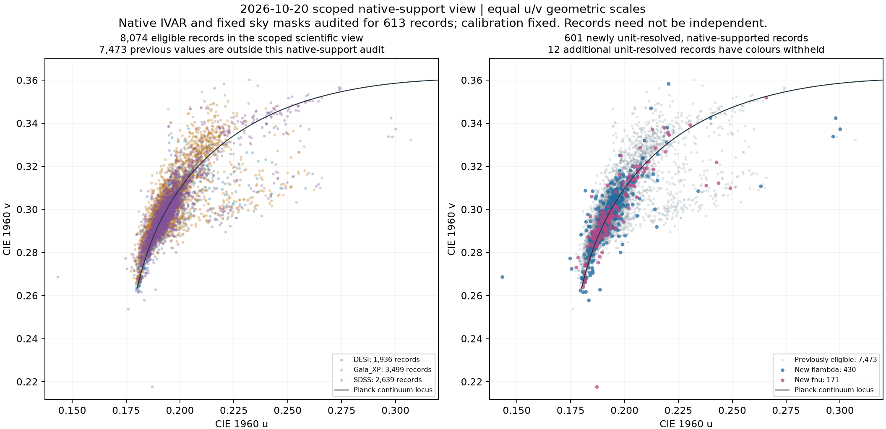

# 原観測による単位解決と、native 支持範囲の追加監査

Work began on 2026-10-19 UTC and was completed on 2026-10-20 UTC. This is an
additive research layer. The previous flux-convention registry, dated screens,
and reviewed figures remain unchanged.

**613 previously unresolved MWDD SDSS records now have a strict native-pixel
unit determination. Native inverse-variance support permits a current colour
for 601; 12 colours are withheld.** These are 613 distinct retained entity
keys, not 613 newly discovered stars or independent observing visits.

## Current results and entry points

| Stage | Eligible records | Strong records | Entity keys with a strong record |
|---|---:|---:|---:|
| Previous unit-aware frozen screen | 7,473 | 395 | 308 |
| Additional unit evidence, existing-recipe compatibility snapshot | 8,084 | 421 | 325 |
| Current view after native-support audit of the additional 613 | **8,074** | **419** | **324** |

The last total combines **601 newly unit-resolved, native-supported colours**
with **7,473 previous values outside this new native-support audit**. The
remaining 9,289 rows did not receive this particular new support audit. It is
not a claim that every record passed a newly applied native-quality gate.
“Strong” retains the exploratory `distance_planck_uv >= 0.01` threshold; it is
not a statistical detection significance or a discovery classification.
[Current definitions and exact counts](science_view_summary.json)

- [Open the current viewer](current_view.html): all 9,902 records and 6,003
  retained entity keys, with source IDs, full fields, the support reason, the
  comparison images, and a separate known-classification context where audited.
- [Current record CSV](science_record_view.csv.gz) and
  [current entity CSV](science_object_view.csv).
- [All 613 individual visual observations](individual_review.md),
  [machine-readable review ledger](individual_review.csv), and
  [review completion / image SHA evidence](review_completion.json).
- [Native support and mask sensitivity](native_quality_metrics.csv.gz),
  [native-quality summary](native_quality_summary.json).
- [J1323: original identity, source position and colour](j1323/README.md).
- [Five spectra flagged by the root reviewer, including a known AM CVn
  counterpart](root_targeted/README.md).
- [Offline verification result](verification_summary.json) and
  [replay implementation](verify_outputs.py).



All eligible points are retained in the figure, with equal geometric scales
for CIE 1960 `u` and `v`. The two panels were actually opened and inspected.
Record counts include alternative representations of an observation; an
archive name is not an independent instrument. Entity representatives are
chosen by calibration availability, instrument, S/N and stable source URL,
without choosing the most extreme colour. Full record IDs remain available.

## 1. What was queried and retrieved

The target universe is the **entire 1,579-record unresolved subset** of the
previous MWDD SDSS registry: 1,286 had no old reference pair; 293 had old pairs
but no accepted native identity. The original row IDs, URLs and raw SHA keys
are in [unresolved_universe.csv](unresolved_universe.csv). The previous
Unavailable review panels supplied 300 entity keys / 301 unresolved records;
J1323 was also included in the initial priority set. This prioritization did
not restrict the final all-1,579 analysis. [Selection and source hashes](selection.json)

For each retained coordinate, `SpecObjAll` was searched within **30 arcsec**,
without a `sciencePrimary`, object-class or colour cut. The official
`fGetNearbySpecObjAllEq` radius is in arcminutes. `SpecObjAll` deliberately
retains repeat or non-primary spectra; those should not be mistaken for
independent astrophysical confirmation.
[SDSS schema documentation](https://skyserver.sdss.org/dr17/en/help/docs/docshome.aspx)
[Function documentation](https://skyserver.sdss.org/dr9/en/help/browser/shortdescr.asp?n=Functions&t=F)

The final 79 successful batches cover every target and yield **2,175 candidate
record/reference associations, involving 2,140 unique original FITS files**.
There are 1,568 records with a candidate and 11 with none inside the stated
cone. A finite cone around retained coordinates can miss an observation
because of epoch, proper motion, catalogue association, archive coverage or
metadata differences. No hit is not evidence that no spectrum exists anywhere.
[Observation associations](catalogue_observations.csv)
[Search ledger](search_ledger.csv)

The initial UNION query form produced 79 HTTP failures. A subsequent VALUES
query form produced the 79 successful batches. **Failures are preserved as
failures, never converted into empty scientific catalogues.** All 474 original
SQL, HTTP response and provenance files are saved byte-for-byte in
[queries_evidence.zip](queries_evidence.zip), with the separate successful and
failed batches in [queries_archive_manifest.json](queries_archive_manifest.json).
The unzipped cache is not required by CI. [Archive replay](archive_queries.py)

The bounded retrieval used four workers and a 2 MB per-file limit. It obtained
all **3,719 planned originals: 1,579 MWDD exports and 2,140 SDSS reference FITS**,
with 0 unresolved retrieval failures and 674,779,985 original bytes. Every
MWDD input matched its frozen raw SHA. Each native reference has its URL,
original SHA, FITS unit, and plate/MJD/fibre header retained.
[Retrieval plan](retrieval_plan_all.json)
[Complete successful retrieval ledger](retrieval_all.json)

## 2. Unit identity is a pixel-level test

SDSS native flux is an `F_lambda` density in units of
`10^-17 erg cm^-2 s^-1 Angstrom^-1`; the exact FITS `BUNIT` is checked. Its
wavelength grid is read from `10**loglam`, without smoothing, interpolation,
continuum fitting, clipping negative flux, or a fitted variable spectral slope.
[Official SDSS spectrum conventions](https://www.sdss4.org/dr17/spectro/spectro_basics/)

The unchanged prior identity test compares two specific hypotheses:

\[
f_{\lambda,\mathrm{export}}=A f_{\lambda,\mathrm{native}},\qquad
f_{\nu,\mathrm{export}}\,c/\lambda^2=A f_{\lambda,\mathrm{native}}.
\]

Only a positive wavelength-independent scale `A` is fitted. Its freedom means
that a successful test establishes the spectral-density convention and shared
sample pattern, not the archive's absolute-luminosity scale.

| Identity requirement | Fixed threshold |
|---|---:|
| Comparison window | 3,600–8,300 Å |
| Nearest native wavelength difference | ≤0.02 Å |
| Wavelength-grid match fraction | ≥0.99 |
| Finite fraction of matched samples | ≥0.99 |
| Relative-comparison samples | ≥1,000 |
| Comparison wavelength span | ≥3,500 Å |
| Maximum fractional residual after one constant scale | <`1e-4` |
| Maximum absolute residual / median absolute native flux | <`1e-4` |

For numerical stability, the fractional test omits division by native flux
smaller than 0.1 times its median absolute value. The separate absolute test
still includes **all finite matched samples, including zero and negative
flux**. Exactly one convention must pass. Ambiguous hypotheses, conflicting
accepted references and references failing the gates remain unresolved.
[Unchanged identity implementation](../precision/flux_convention_audit.py)

This resolves **178 new Fnu and 435 new Flambda records**. The largest accepted
fractional residual is `7.1340263e-6`, below the fixed `1e-4` threshold. The
complete rival-hypothesis residuals, sample counts, scales and chosen reference
are stored for every tested pair.
[All 2,175 pair results and 1,579 dispositions](unit_evidence_all.json)

Combining the untouched old registry and this explicit overlay gives:

| MWDD SDSS convention | Previously verified | Newly verified | Combined |
|---|---:|---:|---:|
| Fnu | 149 | 178 | **327** |
| Flambda | 504 | 435 | **939** |
| Still unresolved | 1,579 | −613 | **966** |

Of the remaining 966, **955 have no reference passing native identity and 11
have no reference in the finite query cone**. The analysis does not infer their
unit from a continuum colour, spectral classification or approximately
quadratic slope. Different reductions, observations, associations or exports
could account for a failure; the present test does not choose between those
causes. [Per-record dispositions](unit_evidence_all.csv)

## 3. Explicit additive integration, with frozen history

[overlay_registry.json](overlay_registry.json) contains only the 613 new,
previously unresolved raw SHA keys. [overlay.py](overlay.py) verifies the old
registry SHA, the new evidence SHA, exact source URL, archive type and the
SHA of the original wavelength/flux numeric arrays. A one-sample change cannot
borrow an unrelated unit decision. Unknown inputs still fail closed.

For a verified Fnu input, `F_lambda = F_nu * c / wavelength_A**2`. When inverse
variance is present, it transforms as `ivar_lambda = ivar_nu / factor**2`.
The verifier checks preservation of signed flux and pixel S/N under this
transformation. It also checks that changed numeric values and still-unresolved
inputs are rejected. The core historical lookup itself is unchanged.

The first new snapshot uses the existing full-grid calibration recipe:
SDSS `gri`, then PS1 `gri` if the SDSS anchor is absent or rejected; 0.02 mag
floor; reject maximum residual ≥0.15 mag or absolute tilt ≥0.25 mag/1,000 Å.
The original grid is used for that fit, followed by the existing narrow sky
mask during colour integration. This is distinct from the previous standardized
clean-grid PS1 headline analysis.
[Compatibility builder](build_current.py)

The compatibility results remain separately available as
[current_record_screen.csv.gz](current_record_screen.csv.gz),
[current_object_screen.csv](current_object_screen.csv) and
[current_summary.json](current_summary.json). They preserve the **8,084 / 421 /
325** comparison stage and do not acquire native errors retroactively.

## 4. Visual inspection exposed a real support problem

The new 39 contact sheets were all actually opened. Reviewers recorded one
observation for every panel: **320 + 160 + 133 = 613**, with exact page, panel,
row, entity and image SHA joins. The 115 previously Unavailable entity keys
whose units were resolved are all included. Image generation and mathematical
identity replay are not counted as image viewing.
[Full individual observations](individual_review.csv)

Long straight connecting segments in several panels, including rows 1910,
3958, 7243, 8288, 8295 and 8330, motivated a support check. A MWDD export can
retain flux but omit its native inverse variance. A strict flux identity does
not make samples with zero native IVAR scientifically usable. SDSS explicitly
instructs users to ignore zero-IVAR pixels.
[Official native-quality guidance](https://www.sdss4.org/dr17/spectro/spectro_basics/)

For all 613 newly resolved records, **every visible native pixel corresponds
to a finite MWDD sample within 0.02 Å**. The new support audit uses only those
corresponding pixels in 3,600–8,300 Å, finite positive native IVAR, and the
fixed sky windows `5577.34±8`, `5890±6`, `5896±6`, `6300.30±8`, `6363.78±8 Å`.
It scales the native representation by the proved constant and applies the
**same previously accepted calibration coefficients**. No new fit is made to
improve agreement or force an expected colour.
[Native-support implementation](native_quality_audit.py)

Ten previously eligible compatibility records fail the existing numerical
coverage gate after this correction:

| Frozen row | Maximum positive-IVAR visible gap (Å) | Current disposition |
|---:|---:|---|
| 113 | 453.12 | Colour withheld |
| 535 | 185.62 | Colour withheld |
| 1910 | 714.91 | Colour withheld |
| 3958 | 714.77 | Colour withheld |
| 4125 | 231.57 | Colour withheld |
| 6165 | 157.52 | Colour withheld |
| 7243 | 333.43 | Colour withheld |
| 8288 | 333.31 | Colour withheld |
| 8295 | 1,113.26 | Colour withheld |
| 8330 | 832.61 | Colour withheld |

Rows 1096 and 6102 were already ineligible, so **12 of the 613 colours are
withheld in total**. All current physical colour fields, channel comparisons,
Planck distances and display swatches are blank for those records. Diagnostic
integrals that bridge the unsupported gap remain in the explicitly labelled
sensitivity table, not in candidate selection. Of the 115 previously
Unavailable objects with new unit evidence, **112 now have supported colours**;
rows 113, 7243 and 8288 account for the other three.
[Scientific-view builder](build_science_view.py)

Among the 601 passing support, row 8342 changes by `Delta uv = 0.001370`;
its Duv changes from `+0.006889` to `+0.005663`. This is the only passing new
record whose change reaches 0.001. The two removed strong records are 535 and
8295. These are numerical consequences of stated support rules, not a new
astrophysical explanation.

The CMF-area proxy still integrates across gaps; it does **not** mean that
99.5% of all wavelength support was directly measured. The inherited endpoint,
CMF-proxy and maximum-gap `<150 Å` gate remains an exploratory screen. Native
positive IVAR supplies reported support, not guaranteed sky subtraction or
calibration. Pixel error propagation assumes diagonal covariance and omits
resampling covariance, calibration, centring and association uncertainties.

AND and OR mask fields are retained separately. AND flags occur in all
contributing exposures; OR flags can occur in only one. An additional
`AND == 0` sensitivity leaves 567 support-passing records, but it is **not**
adopted as a blanket policy. Removing every nonzero OR flag is not justified;
J1323 demonstrates how that can create an almost 1,000 Å gap.
[SDSS mask definitions](https://www.sdss4.org/dr17/algorithms/bitmasks/)
[Spectroscopic caveats](https://www.sdss4.org/dr17/spectro/caveats/)

The 39 reviewed images remain byte-for-byte fixed as compatibility displays.
Their old Duv labels do not override the current support gate. Their grey
envelopes show the complete native min/max in each 40 Å display bin, not an
uncertainty interval. Negative flux is retained; severe vertical compression
and uncertain narrow features are noted individually.

## 5. Reproducibility without a large raw cache

[compact_manifest.json](compact_manifest.json) and the 41 NPZ shards plus
wavelength dictionary preserve **every tested flux and wavelength array**,
including negative values, without rounding. Native SDSS float32 values are
used only when their documented scaling recreates the exact analysis float64
bytes. Otherwise float64 is stored. The selected 613 reference files also
retain native IVAR, AND and OR arrays and quality/header extracts. The compact
arrays total 119,970,680 bytes instead of bundling every 675 MB original.
[Lossless loader and builder](compact_inputs.py)

The original raw SHA authenticates a later redownload. The compact-array SHA
authenticates these exact numerical extractions; an array bundle is not a
replacement original FITS byte stream. Original URLs, raw hashes, headers,
numeric hashes and encoding descriptors remain linked. Three exact compressed
originals are additionally included for the independent J1323 audit.

From any working directory, with the repository's scientific requirements:

```bash
python /absolute/path/to/wish-you-were-green/research/unit_resolution_followup/verify_outputs.py
```

`verify(root)` is also callable by the overall CI. It replays all 2,175 unit
tests from all 3,719 compact inputs, all 613 existing-recipe colour/calibration
decisions, both native-support conditions for every new record, the current
view, every panel/ledger identity, and the J1323 original-file analysis. It
checks lossless HTML data decoding and uses native Node JavaScript to exercise
decompression, filtering, row selection, colour withholding and the known
AM CVn context. This is not a browser-rendering claim. No network, original
raw cache or unzipped query cache is required.

## Scientific consequences and remaining work

The contribution is an auditable correction to research inputs and inference:
unit identity can be established for another 613 records; visible unsupported
segments lead to 10 additional colour holds; J1323 regains qualitative
second-instrument positive-Duv support with explicit precision limits; and a
striking tentative-DQ spectrum is associated with an already published
helium-emission binary. These checks prevent archive representations, missing
support or known binaries from being promoted into new opacity discoveries.

The unresolved 966 need additional original observation or reduction evidence,
not a colour-based unit guess. The old 653 verified MWDD SDSS inputs can be
subjected to the same separate native-quality audit in a future version.
Source positions at each observation epoch, shared calibration anchors,
instrument independence and literature classification remain separate gates
before interpreting abundance, opacity or variability. Neither these counts
nor the nine new green-channel-dominant screen records establish academic
novelty or a newly identified physical mechanism.
