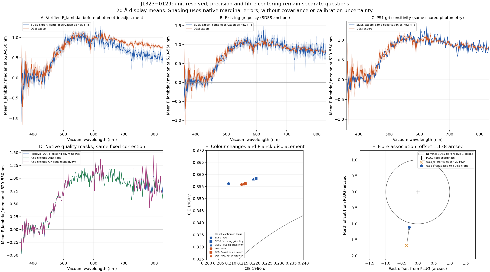

# J1323−0129: 単位は確定、精密な独立確認は保留

**Gaia DR3 3638333660492606976 / frozen MWDD row 13 is an Flambda export of
SDSS plate 4049, MJD 55591, fibre 832.** The unit ambiguity can now be removed
through an explicit additional-evidence overlay. The spectrum's low S/N,
fibre-centering offset and shared photometric calibration remain separate
limitations. Neither the SDSS nor DESI result is green-channel dominant.
[Full numeric results](results.json)

The current native-supported SDSS value is `Duv = +0.0226643`, with display
colour `#FFE15B`, while the existing-recipe DESI value is approximately
`+0.0232289`. This restores **qualitative positive-Duv support from a second
instrument**, not precise independent spectrophotometric corroboration. The
MWDD SDSS export and the newly retrieved SDSS FITS are the **same observation**;
their agreement is not a third spectrum or a repeated observation.
[Current full record view](../science_record_view.csv.gz)

The six panels were actually opened and inspected. Top panels compare the two
instrument exports under three explicitly different conditions. Bottom panels
show mask sensitivity, chromaticity and epoch-propagated position relative to
the nominal fibre. The 20 Å display means and marginal-error shading do not
include calibration or inter-pixel covariance. The OR-mask sensitivity can
bridge missing support and must not be adopted as a valid colour.

## Original-file identity

The newly retrieved reference is
[spec-4049-55591-0832.fits](https://data.sdss.org/sas/dr17/eboss/spectro/redux/v5_13_2/spectra/lite/4049/spec-4049-55591-0832.fits),
with original SHA256
`80b67ebde02a62ed818c1ea17435b3657a5e8e424b0c7c742dfeea5770dbab29`.
The MWDD original SHA is
`438152e144c9297cb7d723c4fe59e7ddd16f489e8a8b0412ec90f27d59982901`.
Exact gzip copies of both originals and the comparison DESI export, together
with URLs and the frozen Gaia row SHA, are in [input_manifest.json](input_manifest.json).

| Test | Flambda hypothesis | Fnu hypothesis |
|---|---:|---:|
| Maximum fractional residual after one constant scale | `5.0344e-6` | `1.35723` |
| Maximum absolute residual / median absolute reference | `5.8772e-6` | `9.67890` |
| Fixed identity threshold | `<1e-4` | `<1e-4` |
| Decision | Pass | Fail |

There are 3,627 finite matched visible samples, of which 3,507 meet the
non-small-reference denominator criterion. The wavelength-grid match is 100%,
spans 4,695.79 Å and has a maximum difference of 0.005602 Å. The fixed native
unit in `BUNIT` is `1E-17 erg/cm^2/s/Ang`. These are native-sample residuals,
not a fitted approximate continuum slope.
[Official SDSS flux and wavelength convention](https://www.sdss4.org/dr17/spectro/spectro_basics/)

Using matched raw or identically corrected spectra, the two representations
of this same observation differ by only `Delta uv = 8.27e-7` and `7.42e-7`,
respectively. That agreement confirms the representation match; it does not
establish correct target centring, atmospheric throughput or a new physical
classification. [Comparisons](comparisons.csv)

## Separate colour/calibration conditions

| Condition | SDSS Duv | DESI Duv | Between-instrument Delta uv |
|---|---:|---:|---:|
| Verified Flambda, without photometric adjustment | +0.027120 | +0.023817 | 0.005388 |
| Existing full-grid gri recipe | +0.022665 | +0.023229 | 0.004939 |
| PS1-only, same full-grid recipe sensitivity | +0.023096 | +0.023482 | 0.004486 |

The exact unrounded values and flags are in [colour_metrics.csv](colour_metrics.csv)
and [comparisons.csv](comparisons.csv). The native-IVAR-supported scientific
SDSS result differs from its rounded-export existing-recipe value by only
`7.42e-7` in uv. Both remain far enough from a precise agreement that the
spectra should not be described as exact independent confirmation.

| Photometric anchor retained in the frozen input | g | r | i |
|---|---:|---:|---:|
| SDSS magnitude | 20.931 | 19.610 | 19.357 |
| SDSS supplied error (mag) | 0.036 | 0.018 | 0.020 |
| PS1 magnitude | 20.64570045 | 19.59639931 | 19.37380028 |
| PS1 supplied error (mag) | 0.025617 | 0.013442 | 0.022473 |

The existing recipe imposes a 0.02 mag floor, rejects a supplied uncertainty
over 0.10 mag, and requires a fitted maximum residual below 0.15 mag and an
absolute tilt below 0.25 mag/1,000 Å. The accepted SDSS correction has offset
`-1.3791761 mag`, tilt `-0.1884370 mag/1,000 Å`, and maximum residual
`0.0494287 mag`. Its tilt-error estimate is `0.0150154 mag/1,000 Å` within the
limited fitting model, not a full calibration-systematic uncertainty.

The fit uses the original full spectral grid. Finite positive IVAR, where
available, and the narrow sky windows are applied for colour integration:
`5577.34±8`, `5890±6`, `5896±6`, `6300.30±8`, `6363.78±8 Å`.
The **PS1-only row above is a sensitivity analysis of this original-grid
recipe**. It does not replace the earlier standardized clean-grid PS1 headline
DESI Duv of approximately `+0.023498`; fitting the clean grid is a different
definition. The old headline and historical screen remain unchanged.

Both calibrated instrument comparisons use the same retained photometric
anchors. Therefore agreement after the constraint is not statistically
independent validation of those anchors. The native FITS also contains SDSS
PSF magnitudes, which differ slightly from the retained MWDD photometry. The
MWDD photometric object ID was not preserved, so this audit does not assume
that those rounded anchors came from an identical photometric-object match.
[All calibration acceptance records](results.json)

## Native quality and masks

The original spectrum contains 4,625 native pixels, with 3,627 in the visible
window. Five have nonpositive IVAR across the full range, four within the
visible window. **498 visible samples have negative flux**, and the median
signed native S/N over 4,000–7,500 Å is only **2.36**. Negative samples are
retained; the spectrum is not made cleaner by clipping them.

57 visible samples have a nonzero AND mask, all with `BRIGHTSKY` set. The OR
mask is nonzero for 1,589 visible samples, with overlapping contributions from
multiple flags. AND and OR count different exposure conditions and are not
interchangeable universal bad-pixel lists.
[Official mask definitions](https://www.sdss4.org/dr17/algorithms/bitmasks/)

| Additional mask, with exactly the same calibration coefficients | Delta uv from native baseline | Maximum visible gap | Coverage gate |
|---|---:|---:|---|
| Require AND mask = 0 | 0.000131 | 19.00 Å | Pass |
| Require OR mask = 0 | 0.053606 | 989.32 Å | **Fail** |

The large OR-mask colour shift is an unsupported-gap sensitivity result. It
is not a valid revised colour. The default current result uses finite positive
native IVAR and the stated sky windows, without blanket OR exclusion.

The conditional maximum uv statistical error is approximately **0.001699**.
This propagates native marginal pixel errors with diagonal covariance and
fixed calibration. It omits correlated resampling errors, calibration,
photometric non-simultaneity, position uncertainty and centring. It cannot be
used as a complete error budget or a discovery significance.

The automatic SDSS template result is `CLASS=QSO`, `z=4.126907`, with
`ZWARNING=4`. The integer value 4 means **bit 2, SMALL_DELTA_CHI2**, not bit 4.
This warned automatic template output is retained as metadata; it is not
adopted as a physical redshift or QSO classification for this object.

## Gaia position at the original observing epoch

The retained Gaia DR3 position is at reference epoch 2016.0. Its proper motion
is `pmra=-16.70383`, `pmdec=-115.38558 mas/yr`. The SDSS night MJD 55591
corresponds to 2011-01-30 UTC. Applying the stated tangential proper motion
changes the separation from the native FITS PLUG position as follows:

| Position used | Separation from SDSS PLUG |
|---|---:|
| Unpropagated Gaia reference-epoch position | 1.71048 arcsec |
| Gaia position propagated to MJD 55591 | **1.13830 arcsec** |

The native PLUG coordinates are `(200.80318, -1.4899599) deg`. The propagated
Gaia coordinates are `(200.8031063384, -1.4902674006) deg`. The nominal BOSS
fibre diameter is 2 arcsec, so the offset is slightly outside the geometric
1-arcsec radius. This is a centring/throughput caution, **not proof of an
incorrect source association or zero collected light**; seeing and acquisition
offsets matter. [BOSS fibre documentation](https://www.sdss4.org/dr17/spectro/spectro_basics/)

This calculation uses no radial velocity, perspective acceleration, annual
apparent parallax, full astrometric covariance, exposure-specific PSF or
atmospheric differential-refraction model. The MJD denotes a night, not an
exact exposure midpoint. It does not provide a posterior association
probability. [Retained Gaia input and SHA](input_manifest.json)

## Reproducible decision

[j1323_audit.py](../j1323_audit.py) reopens the three exact bundled originals,
checks their original hashes and numeric hashes, repeats the rival unit tests,
recalculates all raw/calibrated/mask conditions, and propagates the saved Gaia
position. The overall [offline verifier](../verify_outputs.py) compares the
results and display arrays without a raw cache or network.

The justified update is **unit ambiguity resolved and qualitative
second-instrument positive-Duv support restored**. Precision corroboration,
full astrophysical association and a new physical explanation remain held.
The previous withdrawal remains documented as the correct decision under
the earlier evidence; the new version makes the reason for changing that
unit disposition visible.
