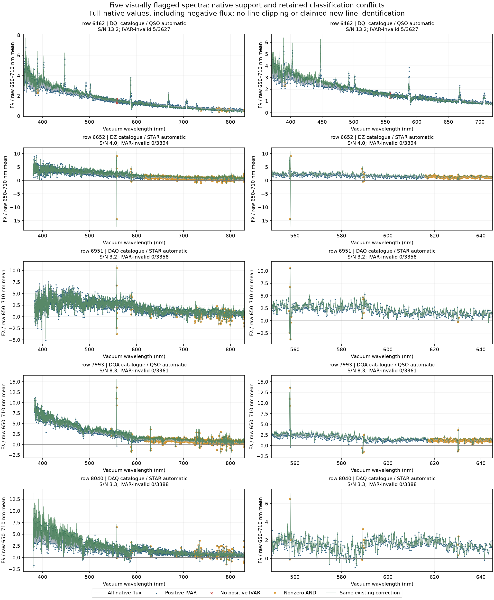

# Five individually flagged spectra: what the native pixels establish

The root reviewer inspected all 160 panels on pages 21–30 and selected these
five cases because of visible narrow positive peaks or broad shape changes.
The selection is recorded in `../root_visual_review_21_30.csv`; it is not an
unbiased sample of instrument failures. [Results and provenance](results.json)
are recalculated by [root_targeted.py](../root_targeted.py) from the compact
original arrays, including native errors and masks.

All ten panels were actually viewed; [visual_review.json](visual_review.json)
records the image SHA and individual observations. Grey/blue curves show
native samples, including negative values. Red crosses lack positive IVAR;
orange circles have a nonzero AND mask. Green uses the same previously fitted
calibration coefficients, without a new fit. An AND flag is a diagnostic here,
not an instruction to discard every flagged sample.

| Row | Preserved catalogue type | Native follow-up | Interpretation |
|---|---|---|---|
| 6462 | DQ: | Multiple strong emission peaks have positive IVAR; only 5/3,627 visible samples lack valid IVAR. | The position and helium-emission pattern support the published AM CVn counterpart SDSS J113732.32+405458.3. Retain the lines and known-binary context. |
| 6652 | DZ | No visible IVAR gap; large signed narrow excursions at the sky wavelengths are AND-flagged. | Low S/N and sky residuals require caution. A broad change is not uniquely identified as a camera error. |
| 6951 | DAQ | No visible IVAR gap; a level change around 590–610 nm remains in native samples. | Existing absorption structure, calibration and low-S/N alternatives remain. Keep the data and withhold a new physical explanation. |
| 7993 | DQA | No visible IVAR gap; broad shape change and flagged narrow sky excursions are distinct. | The automatic QSO label conflicts with the specialist catalogue. Neither template label settles the physical interpretation. |
| 8040 | DAQ | Broad structure around 570–600 nm occurs at low S/N, with narrow flagged sky samples. | Do not flatten this structure merely because it looks unusual. |

The original SDSS automatic classifier reports QSO for rows 6462 and 7993,
with redshifts 0.0763 and 2.9534. These are retained as algorithm outputs, not
adopted redshift measurements for the white-dwarf research sample. The other
three records have STAR labels with different subclasses/warnings. Full fields
are in `results.json`.

## A concrete literature correction: row 6462

[Carter et al. (2014), MNRAS 439, 2848](https://doi.org/10.1093/mnras/stu142)
reported SDSS J113732.32+405458.3 as an AM CVn binary with strong helium
emission. Its published coordinate name lies about 0.38 arcsec from this
original SDSS fibre position. The retrieved observation is plate 4655,
MJD 55620, fibre 930. Its native peaks agree with the published helium-emission
pattern. This supports an existing binary interpretation of the unusual
features; it is not a new binary discovery or a new orbital-period measurement.

[classification_context.json](classification_context.json) preserves the
coordinate calculation, original-file SHA, native peak sample locations and
primary reference. The source should not enter a clean single-photosphere DQ
control set merely because the original inventory has `DQ:`. The inventory
label itself is retained for provenance, and this explanatory context is a
separate overlay. The source is outside the fixed 25-target photometry study.

## Limits of these plots

The full visible-window S/N values here differ slightly from the contact-sheet
reference, which used 4000–7500 Å. Neither estimates calibration uncertainty.
Window means in the results span possible real absorption features and are
not fitted camera discontinuities. Positive IVAR establishes reported support,
not correct sky subtraction, centring, target association or physical models.
No new line removal, abundance fit, variability detection or significance test
was performed on these selected cases.
